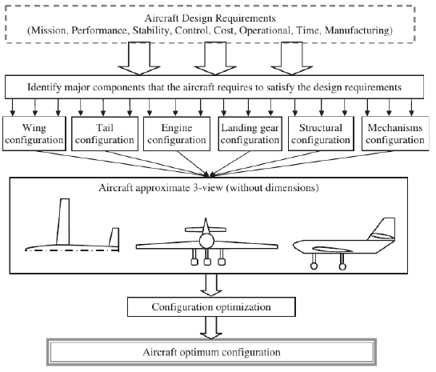

# Conceptual Design  
*Created on:* 2024-12-01  
*Tags:* #conceptalDesign
*Course:* [[AVD]]

---
## Definition
*First and most important phase of the aircraft system design and development process*

- A configuration is generated from general design requirements.
- Selection is the primary tool at this stage.
- More of evaluations and analysis.
- Past design experience is high crucial.
- Trade-off analysis must be done to select the best aircraft configuration.

