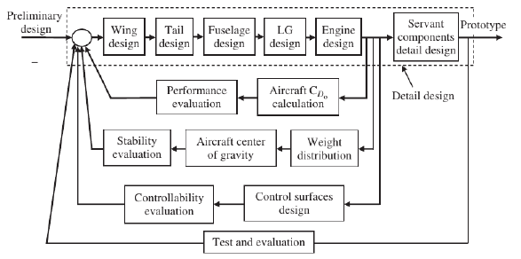

# Design Phases  
*Created on:* 2024-12-01  
*Tags:* #DesignPhases #AircraftDesign
*Course:* [[AVD]]

---
## Definition
*The aircraft design process consists of three design phases namely,*
1. [[Conceptual Design]]: Aircraft configuration design
2. [[Preliminary Design]]: Determination of
	1.  Aircraft maximum take-off weight (MTOW)
	2. Engine Power or Thrust
	3. Wing Reference Area (S)
3. Detail Design
	1. [[Wing design]]
	2. [[Tail design]]
	3. Fuselage design
	4. Propulsion design
	5. Landing Gear design
	6. Structure design
	7. Cabin and cockpit design
	8. Avionics and electrical system design

