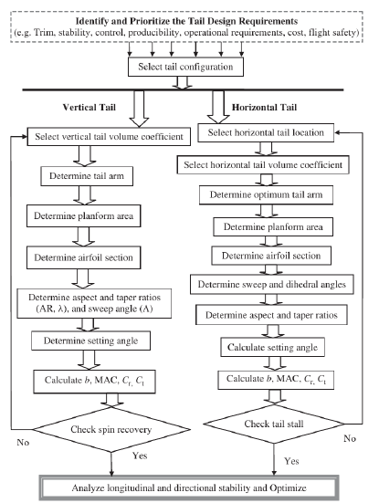
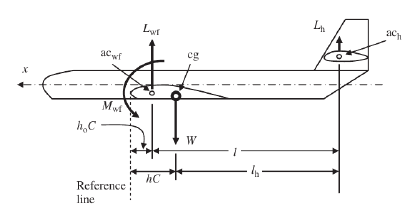
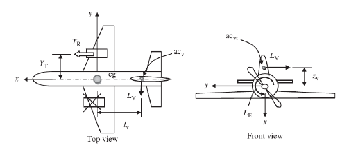

# Tail Design  
*Created on:* 2024-12-01
*Tags:* #tailDesign
*Course:* [[AVD]]

---
## Definition
*The tail in a conventional aircraft often has two components*
	1. Horizontal Tail
	2. Vertical Tail
	   
*and carries two primary functions:*
	1. Trim
	2. Stability

*Elevator* and *Rudder* are present on tail for control of the aircraft.

*Horizontal tail* is responsible for longitudinal trim whereas *vertical tail* is responsible for directional stability.

*Trim* is a condition in which summation of all the forces and moments acting on the aircraft is zero as well involves zero/minimum inputs from pilot/autopilot.

### Longitudinal Trim

Summation of all moments is zero.
$$
\sum M_{cg} = 0
$$
$$
M_{0,wf} + M_{L,wf} + M_{L,h} = 0
$$
$$
\implies M_{o,wf} + L_{wf}(h-h_{0})\bar{C} - L_{h}\cdot l_{h}
$$

$l_{h}$ is the moment arm length.

Non-dimensionalizing the above equation, we have

$$
C_{m_{0},wf} + C_{L}(h-h_{0}) - \eta_{H}\bar{V}_{H} C_{L_{h}} = 0
$$
$\bar{V}_{H}$ is an important non-dimensional parameter referred as horizontal tail volume coefficient. $\eta_{H}$ is the tail efficiency and depends on the tail configuration.

$$
\bar{V}_{H} = \frac{l S_{H}}{\bar{C} S}
$$

### Directional and Lateral Trim

$$
\sum N_{CG} = 0\,\, \implies T_{R}Y_{T} + L_{V}l_{vt} = 0
$$
$$
\sum L_{CG} = 0\,\, \implies L_{E} + L_{V}z_{v} = 0
$$

For static stability,
- $C_{m\alpha}$ < 0
- $C_{l\beta}$ < 0
- $C_{n\beta}$ > 0

For dynamic stability,
- Short period and phugoid modes should be damped.
- Dutch-roll, spiral and roll modes are damped => lateral directional stability.

### Control
Ability of an aircraft to vary the aircraft condition from one trim condition to the other trim condition.

- Highly stable aircraft tends to be less controllable.
- Highly maneuverable aircraft tends to be less stable or even not stable.
- Handling qualities established as standards.

### Design Parameters
Various parameters of design are determined and calculated to obtain a tail which satisfies the requirements.

- *Tail Configuration*
	- Based on selection
	- Comparing advantages and disadvantages of each configuration.
	- Comprise has to be made.
- *Canard or Aft tail*
	- Canards avoid deep stall and has higher efficiency than aft tail.
	- Canards are longitudinally statically less stable.
	- Canards can be used to generate lift as well as used for control.
- *Optimum tail arm*
$$
l_{opt} = K_{c}\sqrt{ \frac{4 \bar{C} S \bar{V}_{H}}{\pi D_{f}} }
$$
-  *Horizontal tail volume coefficient*
	- Selected based on previous aircraft data.
- *Tail lift coefficient*
	- Calculated from the longitudinal stability equation.
- *Fixed, All-moving or Adjustable*
	- Fixed tail is much lighter, cheaper and structurally easier.
	- All moving tail makes aircraft more maneuverable.
	- All moving tail doesn't have control surfaces.
	- Most GA use a fixed tail, large transport aircraft utilize an adjustable tail.
	- Most fighter aircraft employ an all-moving tail.
- *Airfoil selection*
	- Able to generate the required lift at minimum drag.
	- Must create positive and negative lift.
	- Symmetric airfoil chosen
	- Should never stall
	- Must not have compressibility effects.
- *Tail incidence*
	- Typical value would be about -1 deg.
	- Dependent on the required lift and airfoil lift coefficient.
	- For adjustable tail, max and min values should be determined.
- *Aspect Ratio*
	- Elliptical lift distribution not required for tail.
	- In a single engine prop driven aircraft, the AR should be larger than the tail span.
- *Taper Ratio*
	- Influences stability, control, performance, aerodynamic efficiency, weight and CG.
	- To reduce the tail weight.
- *Sweep Angle*
	- Often same as the wing sweep angle.
- *Tail Vertical Location*
	- Positioned such that the tail is out of the fuselage wake region.
- *Vertical tail arm*
	- Often chosen the same as horizontal tail arm
- *Vertical tail volume coefficient*
	- Chosen based on previous aircraft data.

