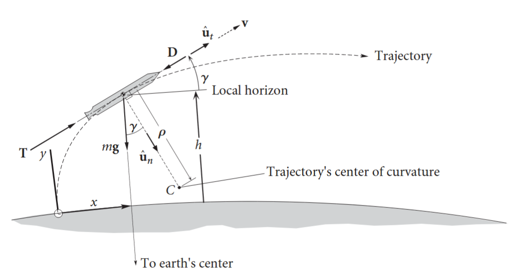

# Mechanics in Transition Orbit  
*Created on:* 2024-12-01  
*Tags:* #EOM
*Course:* [[AVD]]

---
## Definition
*The general equations of motion for a launch vehicle is derived in terms of the variables,*
- Downrange ($x$): Range along the surface of Earth
- Altitude (h)
- Flight Path Angle ($\gamma$)
- Velocity of rocket ($v$)

Balancing the forces in tangential and normal direction, we have

$$
\begin{aligned}
m\,a_{t} = T - D - mg\sin \gamma\\
m\,a_{n} = mg\cos \gamma
\end{aligned}
$$

Now, $a_{t}$ and $a_{n}$ can be defined as,
$$
\begin{aligned}
a_{t} = \frac{dv}{dt}\\
a_{n} = -v\frac{d\gamma}{dt}
\end{aligned}
$$
To account for the Earth's curvature, 
$$
a_{n} = -v\frac{d\gamma}{dt} + \frac{v^2 \cos \gamma}{R_{E} + h}
$$

Therefore by combining the equations we get,

$$
\frac{dv}{dt} = \frac{T}{m} - \frac{D}{m} - g\sin \gamma
$$

$$
v\frac{d\gamma}{dt} = -\left(g-\frac{v^2}{R_{E} + h}\right)\cos \gamma
$$

$$
\frac{dh}{dt} = v\sin \gamma
$$

$$
\frac{dx}{dt} = \frac{R_{e}\,V\cos \gamma}{R_{e} + h}
$$

The trajectory of any rocket can be simulated using the above equations.
