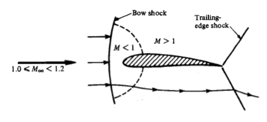

# Compressible Flow 
*Created on:* 2025-01-19
*Tags:* #CompressibleFlow
*Course:* [[Aerodynamics]]

---
## Definition

- Compressible flow is also known as variable density flow.
- The compressibility of the fluid $\tau$ is defined as
$$
\tau = -\frac{1}{v} \frac{dv}{dp}
$$
- The compressibility is the fractional change in volume of the fluid element per unit change in pressure. 
- When a gas is compressed, its temperature tends to increase, depending on the amount of heat transferred into or out of the gas through the boundaries of the system.
- If the temperature of the fluid element is held constant, then the isothermal compressibility
$$
\tau_{T} = -\frac{1}{v}\left(\frac{\partial v}{\partial p}\right)_{T}
$$
- If no heat is added or taken away from the fluid element (if compression is adiabatic), then the compression of the fluid element takes place isentropically, the isentropic compressibility
$$
\tau_{s} = -\frac{1}{v}\left(\frac{\partial v}{\partial p}\right)_{s}
$$
- Liquids have high compressibility while gases have high compressibility.
- Whenever the fluid experiences a change in pressure $dp$, the corresponding change in density will be $d\rho$
$$
\tau = \frac{1}{\rho} \frac{d\rho}{dp}
$$
- For high speed flows involve large pressure gradients. This pressure gradients results in change in density.

## Flow Regimes

The freestream Mach number $(M_{\infty})$ is defined as the ratio of free-stream velocity $V_{\infty}$ and speed of sound in the freestream $a_{\infty}$. 

### Subsonic Flow

- Flow with $M_{\infty} \le 0.8$.
- The flow has smooth streamlines and continuously varying properties.
- The local Mach number over the top of the airfoil is still subsonic.

### Transonic Flow

- If $M_{\infty}$ remains subsonic but is sufficiently near 1, the flow expansion over the top surface of the airfoil. This mixed region flow is defined as transonic flow.
- A pocket of supersonic flow is created over the top surface of the airfoil. This terminates with a shockwave and creates a region of discontinuity.
- If $M_{\infty}$ is increased to slightly above unity, the shock pattern will move to the trailing edge of the airfoil, and a second shock wave appears upstream of the leading edge. This second second shock wave is called the bow shock.

### Supersonic Flow

- A flow field where $M >1$ everywhere is defined as supersonic.

### Hypersonic Flow

- As $M_{\infty}$ is increased to higher supersonic speeds, flow properties increases become more severe.
- $M_{\infty}>5$ is considered hypersonic flow. It is rule of thumb.

## Conservation Equations for Inviscid Flows

### Continuity Equation

$$
\frac{\partial}{\partial t} \iiint_{\mathcal{V}} \rho\,dd\mathcal{V} + \iint_{S} \rho \mathbf{V} \cdot d\mathbf{S} 
$$
### Momentum Equation
$$
\iint_{S} (\rho \mathbf{V}\cdot d\mathbf{S})\mathbf{V} + \iiint_{\mathcal{V}} \frac{\partial(\rho \mathbf{V})}{\partial t} d\mathcal{V} = \iiint_{\mathcal{V}} \rho \mathbf{f} d\mathcal{V} - \iint_{S} p\,dS
$$
- This is the integral formulation of Newton's second law applied to inviscid fluid flows.

### Energy Equation

$$
\iiint_{\mathcal{V}} \dot{q} \rho d\mathcal{V} - \iint_{S} \rho \mathbf{V} \cdot d\mathbf{S} + \iiint_{\mathcal{V}} \rho (\mathbf{f} \cdot \mathbf{V})\,d\mathcal{V} = \iint_{S} \rho\left( e+\frac{V^2}{2} \right)\mathbf{V}\cdot d\mathbf{S} + \iiint_{\mathcal{V}} \frac{\partial}{\partial t}\left[ \rho\left( e+\frac{V^2}{2} \right) \right]
$$

- First term represents the rate of heat added to the fluid inside the control volume from the surroundings.
- 2nd and 3rd term represents the rate of work done on the fluid inside the control volume.
- Last two represent the rate of change of energy of the fluid as it flows through the control volume.