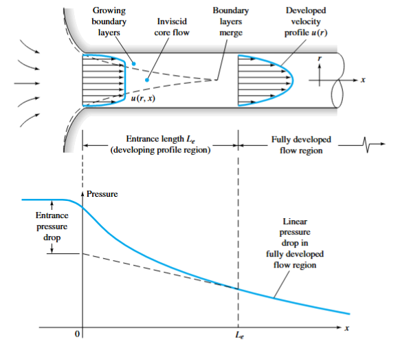

# Elementary Viscous Flows 
*Created on:* 2025-01-12  
*Tags:* #PoiseuilleFlow #CouetteFlow
*Course:* [[Aerodynamics]]

---
## Couette Flow

- Two-dimensional incompressible flow
- Flow between a fixed and a moving plate
- Viscous Flow
- Assumption: Plates are very wide and long.
- Only $u\ne0$ and $v=w=0$
- The upper plate moves with a velocity $V$ but no pressure gradient is present.

### Continuity Equation

$$
\frac{\partial u}{\partial x} = 0 \implies u = u(y)
$$
The velocity doesn't vary with $x$ and is known as a fully-developed flow.

### Momentum Equation

$$
\rho\left(  \frac{\partial u}{\partial x} + \frac{\partial v}{\partial y}\right) = - \frac{\partial p}{\partial x} + \mu \left(\frac{\partial^2 u}{\partial x^2} + \frac{\partial^2 u}{\partial y^2}\right)
$$
Substituting the values, we get
$$
\frac{\partial^2 u}{\partial y^2} = 0 \implies u = C_{1}y + C_{2}
$$

Now, at $y=h$
$$
u = V \implies C_{1}h + C_{2} = V
$$
And at $y=-h$
$$
u=0 \implies -C_{1}h + C_{2} = 0
$$
Thus,
$$
u(y) = \frac{V}{2h}y + \frac{V}{2}
$$

The flow has a linear velocity profile with no-slip at each wall. 

## Poiseuille Flow

- Both plates are fixed ($V=0$).
- The pressure varies in the $x$ direction.
- $u \ne 0$ and $v=w=0$, thus $u = u(y)$.

Using the $x$ momentum equation, we have
$$
\mu \frac{d^2 u}{d y^2} = \frac{d p}{d x} = const < 0
$$
Integrating, we get
$$
u = \frac{1}{\mu} \frac{dp}{dx} \frac{y^2}{2} + C_{1}y + C_{2}
$$
Now, at $y= \pm h$ the value of $u$ is 0. Thus,
$$
u = -\frac{dp}{dx} \frac{h^2}{2\mu}\left( 1-\frac{y^2}{h^2} \right)
$$

## Viscous Flow in Ducts

- Flow transitions from Laminar to Turbulent at approximately $\mathrm{Re}_{D} \approx 2300$ but can be delayed using smoothing.

### Internal v/s External Flow

- An internal flow is constrained by the bounding walls.
- The viscous effects will meet and permeate the entire flow.
- The flow at inlet is nearly inviscid.
- The boundary layers grow downstream and meet at a point turning the whole flow as viscous.
- After a distance $L_{e}$, the flow is independent of $x$ and known as fully-developed flow. The distance $L_{e}$ is known as entrance length.

For laminar flow, $\frac{L_{e}}{d} \approx 0.06 \mathrm{Re}$. In turbulent flow, the boundary layers grow faster and hence the entrance length is small.

## Flow in a circular pipe

- Steady flow.
- Fully developed.
- No shaft work or heat-transfer effects.

The friction head-loss $h_{f}$ is given as
$$
h_{f} = \Delta z + \frac{\Delta p}{\rho g}
$$
Now, the head-loss is equal to
$$
h_{f} = f \frac{L}{d} \frac{V^2}{2g}
$$
Here, $f$ is the Darcy friction factor which is a function of $\mathrm{Re}_{D}$ and $\varepsilon$ i.e. wall-roughness height.

The wall roughness height induces turbulence and hence effects the flow inside the pipe.

- Higher roughness --> Higher Friction factor and Quicker Turbulence achieved.

Moody Diagram is used to find out the value of $f$ for turbulent flows otherwise for laminar flow $f=\frac{64}{\mathrm{Re}}$.

 Hydraulic Diameter ($D_{H}$) = $\frac{4A}{P}$ = $\frac{4\times\text{area}}{\text{wetted perimeter}}$
 
