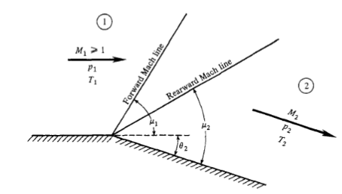

# Prandtl - Meyer Expansion Waves 
*Created on:* 2025-01-20
*Tags:* #ExpansionWaves
*Course:* [[Aerodynamics]]

---
## Definition

- When a supersonic flow is turned away from itself.
- This is directly opposite to the situation when the flow is turned into itself.
- An expansion corner is a means to increase the flow Mach number.
- The expansion fan itself is a continuous expansion region composed of an infinite number of Mach waves bounded upstream $\mu_{1}$ and downstream by $\mu_{2}$ where $\mu_{1}=\arcsin(1/M_{1})$ and $\mu_{2}=\arcsin(1/M_{2})$.
- Streamline through an expansion waves are smooth curved lines.
- The expansion is isentropic since the expansion takes place through a continuous succession of Mach waves.

The Prandtl-Meyer function describes the expansion angle through which a supersonic flow turns to reach a given Mach number, accounting for the isentropic expansion of the flow. It is defined as:

$$\nu(M) = \sqrt{\frac{\gamma+1}{\gamma-1}} \arctan\left(\sqrt{\frac{\gamma-1}{\gamma+1}(M^2-1)}\right) - \arctan\left(\sqrt{M^2-1}\right)$$
$$
\theta_{2} = \nu(M_{2}) - \nu(M_{1})
$$

The value of Prandtl-Meyer function for various M values is listed in a table which can be used for the calculations.
