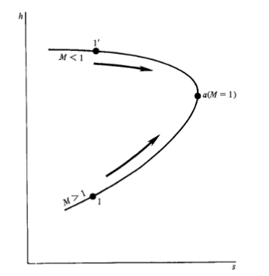

# Fanno Flow 
*Created on:* 2025-01-19  
*Tags:* #FannoFlow
*Course:* [[Aerodynamics]]

---
## Definition

- One-dimensional, steady, compressible and shockless flow.
- Adiabatic flow.
- Momentum equation is modified to accommodate for the effect of friction.
$$
(p_{2}-p_{1}) + (\rho_{2}u_{2}^2 - \rho_{1}u_{1}^2) = -\frac{4}{D} \int_{0}^L \tau_{w}\,dx
$$
- A relation between the Mach number at two different sections is obtained as a effect of friction.
- The reference condition for flow properties is the place where $M=1$ and the location is defined as $x=L^*$.
- The solution of the equations are tabulated in the Fanno flow table.
- Similar to Rayleigh flow, the friction always drives the Mach number toward 1.

