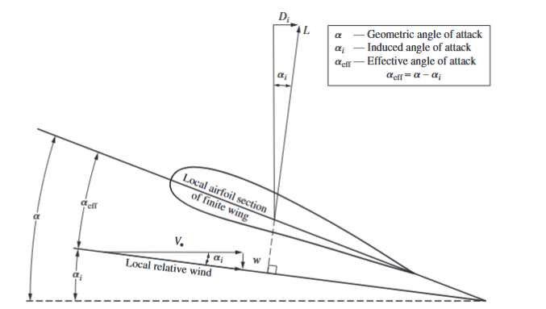

# Finite Wing 
*Created on:* 2025-01-14  
*Tags:* #FiniteWing #InducedDrag
*Course:* [[Aerodynamics]]

---
## Downwash and Induced Drag

- Flow over an airfoil is two-dimensional whereas flow over a finite wing is three-dimensional.
- The existence of high-pressure on the bottom surface and low pressure on the top surface creates the lift.
- The imbalance causes the flow to curl from the high-pressure region below the tip to the low-pressure region on top.
- Thus, there is a flow component from tip toward the root. This bends the streamlines toward the root on top surface whereas towards the tip on bottom surface.
- This flow creates a circulatory motion that trails downstream of the wing. A trailing vortex is created at each wing tip.
- These wingtip vortices induces a small downward component of air velocity in the neighborhood of the wing itself.
- The downward component is called downwash.
- It combines with the freestream velocity $V_{\infty}$ to produce a local relative wind.

- The angle of attack seen by the airfoil is $\alpha_{eff}$ which is between the chord and local relative wind.
- $\alpha_{eff} = \alpha - \alpha_{i}$ where $\alpha$ is the geometric angle of attack and $\alpha_{i}$ is the induced angle of attack.
- $\alpha_{i} = w/V_{\infty}$ assuming $\alpha_{i}$ is small.
- The local lift vector is aligned perpendicular to the local relative wing and hence is inclined by the vertical by the angle of $\alpha_{i}$.
- There is component of local lift vector in the direction of $V_{\infty}$. This is a drag created by the presence of downwash and known as induced drag ($D_{i}$).
- Total Drag = Profile Drag + Induced Drag
- Profile Drag = Pressure Drag + Skin Friction Drag

The velocity induced at a given point P by an infinite straight vortex filament at at a perpendicular distance $h$ is
$$
V = \frac{\Gamma}{2\pi h}
$$

For a semi-infinite vortex filament,
$$
V = \frac{\Gamma}{4\pi h}
$$

## Helmholtz's Vortex Theorems

1. The strength of a vortex filament is constant along its length.
2. A vortex filament cannot end in a fluid. It must extend to the boundaries of the fluid or form a closed path.

Lift distribution along the span of a finite wing can be a function of spanwise distance owing to twist and flow over the wing.

