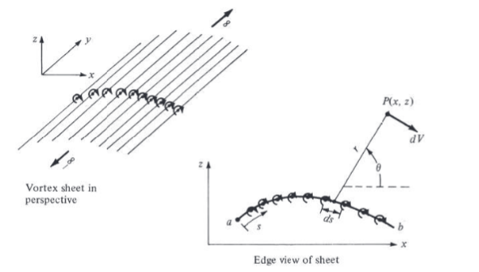
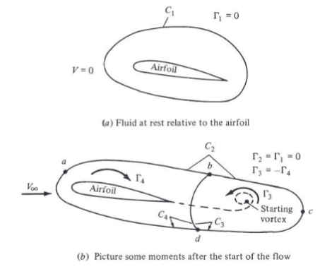

# Kutta-Joukoswki Theorem 
*Created on:* 2025-01-13
*Tags:* #Kutta-JoukoswkiTheorem #StartingVortex #KuttaCondition
*Course:* [[Aerodynamics]]

---
## Vortex Filament

A straight line perpendicular to the page, going through the center of a point vortex and extending to infinity on both sides is known as a straight vortex filament.

- Positive Vortex Strength: Clockwise Rotation
- Negative Vortex Strength: Anti-clockwise Rotation

## Vortex Sheet

An infinite number of line sources side-by-side, with the strength of each line source being infinitesimally small, form a vortex sheet.

The small velocity induced at point P by a small section of the vortex sheet of strength $\gamma ds$ is given by
$$
dV = -\frac{\gamma ds}{2\pi r}
$$
Whereas the velocity potential is given as 
$$
d\phi = - \frac{\gamma ds}{2 \pi} \theta
$$

The potential is preferred to eliminate the vector addition in case of velocity, thus the velocity potential at P due to the entire vortex sheet is 
$$
\phi(x,z) = \frac{1}{2\pi} \int_{a}^b \theta \gamma\, ds
$$
Also, 
$$
\Gamma = \int_{a}^b \gamma\,ds
$$
There is a local jump in tangential velocity across the vortex sheet is equal to the local strength.
$$
\gamma = u_{1} - u_{2}
$$
Where $u_{1}$ is the velocity above the sheet and $u_{2}$ is the velocity below below the sheet.

## Kutta-Joukowski Theorem

- The airfoil surface is replaced with a vortex sheet of variable strength $\gamma(s)$.
- The strength varies such that the induced velocity combined with free-stream velocity creates a streamline of the flow.
- The circulation around the airfoil will be given by
$$
\Gamma = \int \gamma\,\,ds
$$
- The lift is given by the Kutta-Joukowski Theorem states that
$$
L = \rho_{\infty}V_{\infty}\Gamma
$$

## Kutta Condition

- Theoretically, there are infinite number of potential flow solutions for infinite values of $\Gamma$.
- But from experiments, we know that only one solution exists.
- Hence, we need to fix one solution which corresponds to the nature.
- For trailing edge with finite angle, $V_{1}=V_{2}=0$ otherwise the point would have two velocities in two different directions.
- For cusped edge, $V_{1}=V_{2} \ne 0$ i.e. $V_{1}$ and $V_{2}$ are in same direction and can be finite.
- The strength of the vortex sheet $\gamma$ at the TE is given as
$$
\gamma\,(TE) = V_{1} - V_{2} 
$$
Now, for both cases $V_{1}=V_{2}$, hence $\gamma\,(TE)=0$.

- Nature enforces the Kutta condition by means of friction.

## Kelvin's Circulation Theorem

The theorem states that the circulation around a simple closed curve remains constant in inviscid incompressible and inviscid barotropic flow.
$$
\frac{D\Gamma}{Dt} = 0
$$

## Starting Vortex

The generation of circulation around the airfoil is answered by the Kelvin's circulation theorem.

- Initially, the airfoil is at rest and the circulation around the airfoil is zero.
- The tendency of flow to curl around the trailing edge creates a large velocity region with large gradients (large vorticity). This region moves downstream and rolls up to form a vortex.
- This vortex is known as starting vortex and has a finite negative circulation.
- To counter this an equally positive circulation is formed around the airfoil.

