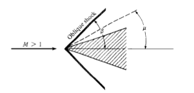

# Oblique Shocks 
*Created on:* 2025-01-19 
*Tags:* #ObliqueShocks
*Course:* [[Aerodynamics]]

---
## Mach Wave and Mach Angle

- Wave fronts from a disturbance envelope given by the straight line $BC$, which is tangent to the family of circles. This line of disturbance is defined as the Mach wave.
- The angle between the Mach wave and the direction of motion of the body is defined as Mach angle $\mu$.
$$
\mu = \sin^{-1} \frac{1}{M}
$$

## Definition

- Oblique shocks are shocks turned into themselves.
- If the disturbances are stronger , they coalesce into an oblique shock at an angle $\beta$ to the freestream, where $\beta>\mu$.
- Mach wave is an infinitely weak oblique shock.

## Oblique Shock Relations

- Normal and tangential components of the Mach number are considered $M_{n_{1}}$ and $M_{t_{1}}$.
- The continuity equation for an oblique shock remains the same.
$$
\rho_{1}u_{1} = \rho_{2}u_{2}
$$
- The momentum equation is split into components (i.e. tangential and normal).
$$
\begin{gathered}
\rho_{1}u_{1}w_{1} = \rho_{2}u_{2}w_{2}\\
p_{1} + \rho_{1}u_{1}^2 = p_{2} + \rho_{2}u_{2}^2
\end{gathered}
$$
- The tangential component of the flow velocity is preserved across an oblique shock wave.
- The energy equation is simplified to 
$$
h_{1} + \frac{u_{1}^2}{2} = h_{2} + \frac{u_{2}^2}{2}
$$

- These equations are identical to normal shock relations for the normal velocity component.
- Therefore, the changes across an oblique shock wave are governed by the normal component of the free-stream velocity.
- The solution is found using $M_{n_{1}} = M_{1}\sin \beta$.
- The Mach number after the oblique shock $M_{2}$ is given as
$$
M_{2} = \frac{M_{n_{2}}}{\sin(\beta-\theta)}
$$
- Normal shocks are just a special case of oblique shocks for $\beta=\pi/2$.
- The value of $M_{2}$ is dependent on the flow deflection angle $\theta$. 
- The value of $\theta$ is governed by the $\theta-\beta-M$ relation since it is dependent on the value of $\beta$ and $M_{1}$.

## $\theta-\beta-M$ Relation

- For any given $M_{1}$, there is a maximum deflection angle $\theta_{max}$. If the physical geometry is such that $\theta>\theta_{max}$ then no solution exists for a straight oblique shock wave. Instead the shock will be curved and detached.
- For any given $\theta<\theta_{max}$, there are two values of $\beta$ for a given Mach number. 
- Large value of $\beta$ --> Strong shock whereas small value of $\beta$ --> Weak shock.
- Weak shock is favored in nature and usually occurs.