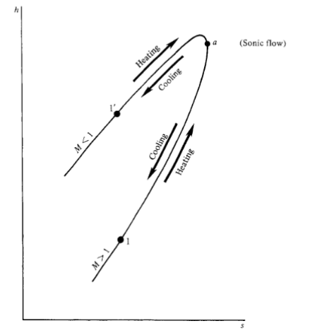

# Rayleigh Flow 
*Created on:* 2025-01-19  
*Tags:* #RayleighFlow
*Course:* [[Aerodynamics]]

---
## Definition

- Changes in one-dimensional flow is created by heat addition without the presence of a shock wave.
- Governing phenomenon in turbojet and ramjet engine burners.
$$
\begin{gathered}
\rho_{1}u_{1} = \rho_{2}u_{2}\\
p_{1} + \rho_{1}u_{1}^2 = p_{2} + \rho_{2}u_{2}^2\\
h_{1} + \frac{u_{1}^2}{2} + q = h_{2} + \frac{u_{2}^2}{2}
\end{gathered}
$$
- The energy equation in terms of total enthalpy
$$
h_{01} + q = h_{02} \implies q = h_{02} - h_{01} = c_{p}(T_{02}-T_{01})
$$
- The heat addition changes the total temperature of the flow.
- The solution of the above equations are tabulated in Rayleigh Flow table.

## Solution Strategy

- All conditions in region 1 (Inlet) are given.
- Find $M_{1}$ and $T_{01}$. 
- For a given value of $q$, find the value of $T_{02}$.
- Use the value of $T_{02}$ to find $M_{2}$.
- From $M_{2}$, find the conditions in region 2 (Outlet).
- The sonic conditions are used as reference for $\frac{p_{2}}{p_{1}}$, $\frac{T_{2}}{T_{1}}$, etc.
- The current flow is non-adiabatic, hence $T^*$, $p^*$, and $\rho^*$ are those conditions in the flow that would exist if enough heat is added to achieve Mach 1.

## Rayleigh Curve

- For addition of heat 
	- Supersonic Flow ($M>1$) --> Sonic Flow ($M=1$).
	- Subsonic Flow ($M<1$) --> Sonic Flow ($M=1$).
- That is, heat addition always drive the flow towards the sonic condition.

- The h-s curve (Mollier diagram) is known as Rayleigh curve.
- For both subsonic and supersonic flow, for a certain value of $q$ the flow will become sonic in Region 2. The flow is said to be choked because any further increase in $q$ is not possible without drastic revision of the upstream conditions in region 1.
- In both subsonic and supersonic cases, once the flow is choked, further heat addition does not affect the mass flow rate. Instead, the flow adjusts by increasing temperature and further reducing stagnation pressure, leading to potential adverse effects such as flow separation or instability in practical systems.