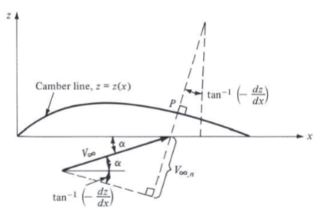

# Thin Airfoil Theory 
*Created on:* 2025-01-14  
*Tags:* #ThinAirfoilTheory
*Course:* [[Aerodynamics]]

---
## Assumptions

- Inviscid Flow
- Incompressible Flow
- Thin airfoils
- Vortex Sheet on Airfoil $\implies$ Vortex Sheet on Camber Line $\implies$ Vortex Sheet on Chord Line.
- Camber line is the streamline of the flow.
- Small Angle of Attack

For camber line to be the streamline of the flow, the component of velocity normal to the camber line must be zero at all points along the camber line.
$$
V_{\infty,n} + w'(s) = 0
$$

The expression for $V_{\infty,n}$ is given as 
$$
V_{\infty,n} = V_{\infty}\sin\left[ \alpha+\tan^{-1}\left( -\frac{dz}{dx} \right) \right]
$$
For thin airfoil at small angle of attack both $\alpha$ and $\tan^{-1}\left( -\frac{dx}{dx} \right)$ are small values. Using the approximation that $\sin \theta \approx \tan \theta \approx \theta$.

$$
V_{\infty,n} = V_{\infty}\left( \alpha-\frac{dz}{dx} \right)
$$

Since camber line is close to the chord line, hence we approximate that 
$$
w'(s) \approx w(x)
$$
The velocity $w(x)$ induced at point $x$ by all elemental vortices along the chord line is
$$
w(x) = - \int_{0}^c \frac{\gamma(\xi)d\xi}{2\pi(x-\xi)}
$$
Now,
$$
V_{\infty}\left( \alpha-\frac{dz}{dx} \right) - \int_{0}^c \frac{\gamma(\xi)d\xi}{2\pi(x-\xi)} = 0 
$$
Or
$$
\frac{1}{2\pi}\int_{0}^c \frac{\gamma(\xi)d\xi}{(x-\xi)} = V_{\infty}\left( \alpha-\frac{dz}{dx} \right)
$$

The above equation is known as the fundamental equation of thin airfoil theory. It is solved for the value of $\gamma(\xi)$ subjected to the boundary condition $\gamma(c)=0$.

## Symmetric Airfoil

- No camber i.e. camber line and chord line coincide
- $\frac{dz}{dx} = 0$
$$
\frac{1}{2\pi}\int_{0}^c \frac{\gamma(\xi)d\xi}{(x-\xi)} = V_{\infty}\alpha
$$
The variables $\xi$ and $x$ are transferred in terms of $\theta$
- $\xi = \frac{c}{2}(1-\cos \theta)$
- $x=\frac{c}{2}(1-\cos \theta_{0})$

Thus,
$$
\frac{1}{2\pi}\int_{0}^\pi \frac{\gamma(\theta)\sin \theta d\theta}{(\cos \theta-\cos \theta_{0})} = V_{\infty}\alpha
$$
The solution to the above problem is
$$
\gamma(\theta) = 2\alpha V_{\infty} \frac{1+\cos \theta}{\sin \theta}
$$
Also satisfies the Kutta Condition.

The total circulation is given as 
$$
\Gamma = \frac{c}{2}\int_{0}^\pi \gamma(\theta)\sin \theta\, d\theta = \pi \alpha c V_{\infty}
$$
The lift per unit span is given as
$$
L' = \rho_{\infty} V_{\infty} \Gamma = \pi \alpha c \rho_{\infty}V_{\infty}^2
$$
$$
C_{l} = \frac{L'}{q_{\infty}S} = 2\pi \alpha
$$

- The thin airfoil theory states that the lift coefficient of all symmetric thin airfoil at low angle of attacks is given by $2\pi \alpha$.
- The center of pressure and aerodynamic center of a symmetric airfoil both coincide on the $c/4$.

## Cambered Airfoil

- A similar analysis can be done for the cambered airfoils.
- The coefficients are found with the help of Fourier analysis.

$$
c_{l} = 2\pi\left[ \alpha + \frac{1}{\pi} \int_{0}^\pi \frac{dz}{dx} (\cos \theta_{0}-1)d\theta_{0} \right]
$$
And 
$$
\text{Lift Slope} = \frac{dc_{l}}{d\alpha} = 2\pi
$$

The second term in the equation of $c_{l}$ is the negative of $\alpha_{L=0}$ i.e.
$$
\alpha_{L=0} = - \frac{1}{\pi} \int_{0}^\pi \frac{dz}{dx} (\cos \theta_{0}-1) d\theta_{0}
$$
The $C_{m,c/4}$ is independent of $\alpha$, thus it is theoretical location of aerodynamic center for the cambered airfoil.
