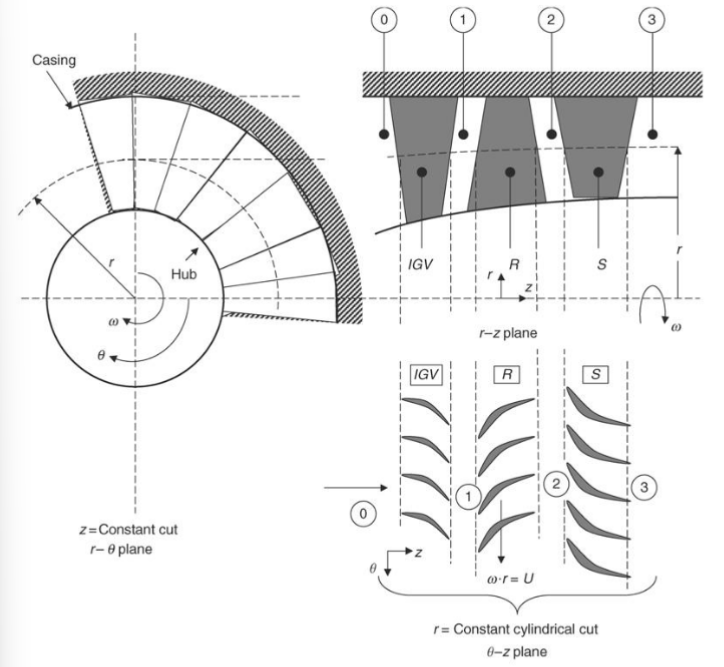
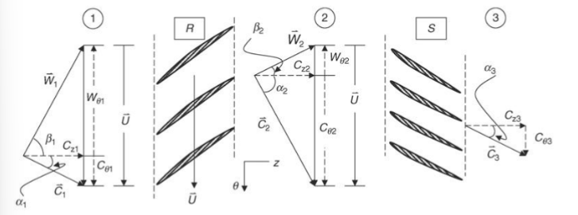

# Axial Compressor 
*Created on:* 2025-02-09  
*Tags:* #AxialCompressor
*Course:* [[Airbreathing Propulsion]]

---
## Basics of turbomachinery

- The energy transfer between the blades and the fluid takes place in an a turbomachinery through a set of rotating blades called rotors.
- Stationary blades called the stator follow the rotor blades.
- A rotor and a stator comprise a turbomachinery stage.
- The rotors are attached to the hub and hence the reaction of the blade forces and moments is exerted on the fluid.
- Whereas the stator are cantilevered from the casing and perform no work on the fluid.
- Absolute observer: An observer sitting on the casing. It sees an unsteady flow through the rotor.
- Relative observer: An observer sitting on the rotor. It sees a steady flow through the rotor.
- The components of the velocity are connected through
$$
\text{Relative Swirl} = \text{Absolute Swirl} - \omega r
$$
- Let the absolute velocity vector and the relative velocity vector be 
$$
\vec{C} = C_{r}\hat{r} + C_{\theta}\hat{\theta} + C_{z}\hat{z}
$$
$$
\vec{W} = W_{r}\hat{r} + W_{\theta}\hat{\theta} + W_{z}\hat{z}
$$
- The rotor blade spins an angular velocity $\omega$, hence it describes a solid body rotation as
$$
\vec{U} = \omega r\hat{\theta}
$$
- Thus, 
$$
\vec{W} = \vec{C} - \vec{U}
$$
- These vectors form a triangle known as velocity triangle.
- The $\hat{\theta}$ component of the velocity is referred to as the swirl component.

## Euler Turbine Equation

- The fluid angular momentum about the axis of rotation is given as
$$
\text{Fluid Angular Momentum} = \dot{m}rC_{\theta}
$$
- The change of fluid angular momentum between the exit and inlet of the stream tube is the applied torque exerted by the blade on the fluid, that is,
$$
\dot{m}(r_{2}C_{\theta2}-r_{1}C_{\theta1}) = \tau_{fluid}
$$
- The power transmitted to the fluid is given as
$$
P = \dot{m}\omega \Delta(rC_{\theta})
$$
- The specific work is given as 
$$
w = \frac{P}{\dot{m}}
$$

- The change of total enthalpy of the fluid across the blade row is equal to the specific work 
$$
h_{t2} - h_{t1} = w
$$

## Axial-flow versus Radial-flow machines

- In an axial flow turbomachinery, the fluid path is predominantly along the axis of rotation.
- In radial flow, the fluid path departs from axial and attains a predominantly radial motion at the exit.
- In axial flow, $r_{1}\approx r_{2}\approx r$.
- The Euler turbine equation may be simplified to 
$$
w_{c} = U(C_{\theta2} - C_{\theta1})
$$
- Pitchline radius of an axial-flow turbomachinery is assumed to represent the mean or average of the flowfield properties in the annulus and thus serves as the first line of attack in a one-dimensional flow analysis approach.
$$
r_{m} = \frac{r_{h}+r_{t}}{2}
$$

## Axial-flow compressors

- Provide mechanical compression for the airstream that enters a gas turbine engine.
- For large pressure rise, stages are stacked together.
- In a stage, the rotor blade imparts angular momentum to the fluid, while the stator blade row removes the angular momentum from the fluid.

- The rotor and stator torques are given as
$$
\tau_{rotor} = -\dot{m}\cdot r(C_{\theta2}-C_{\theta1})
$$
$$
\tau_{stator} = -\dot{m}\cdot r(C_{\theta3}-C_{\theta2})
$$
- We assume that the absolute swirl and angular momentum across the stage remains the same i.e. $C_{\theta1}=C_{\theta3}$
$$
\tau_{rotor}=-\tau_{stator}
$$
- The flow angle are measured with respect to the axial direction and labeled as $\alpha$ and $\beta$ which correspond to the absolute and the relative flow velocity vector $\vec{C}$ and $\vec{W}$.

- The relative velocity vector at the exit of the rotor $\vec{W}_{2}$ should nearly be tangent to the rotor suction surface at the trailing edge. Hence, $\beta_{2}$ is fixed by the geometry of the rotor and remains nearly constant over a wide operating range of the compressor.
- Similarly $\alpha_{1}$ or $\alpha_{3}$ stay constant over the operating range.
- The flow angles $\alpha_{2}$ and $\beta_{1}$ change with rotor speed $U$.
- A repeated stage or normal stage refers to
$$
\vec{C}_{3} = \vec{C}_{1}
$$
$$
\alpha_{3} = \alpha_{1}
$$
- As a result, $|\beta_{2}|=|\alpha_{1}|$ and $|\alpha_{2}|=|\beta_{1}|$.
- The flow coefficient is defined as
$$
\phi = \frac{C_{z}}{U}
$$
- The stage degree of reaction $^\circ R$ is defined as the fraction of static enthalpy rise across the stage that is accomplished by the rotor.
- The stator takes out the swirl put in by the rotor and thus converts it to a static pressure rise.
$$
^\circ R = \frac{h_{2}-h_{1}}{h_{3}-h_{2}} = 1 - \frac{C_{\theta1} + C_{\theta2}}{2U}
$$

- The flow is more stable over the rotor as compared to the stator, hence a slightly higher burden of static pressure rise is allocated to the rotor.
- 