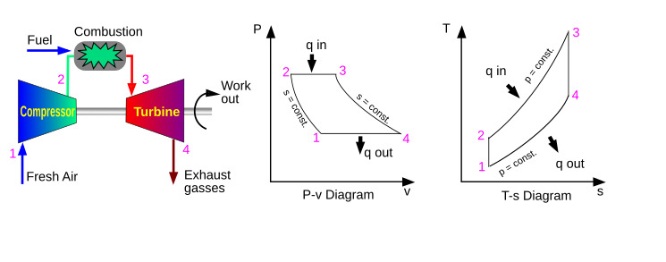
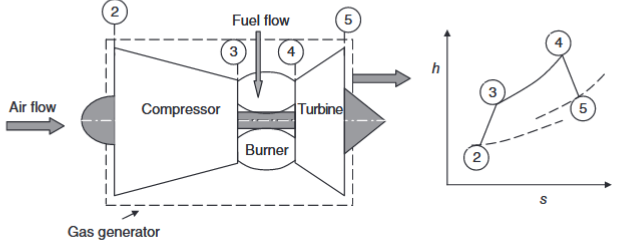

# Brayton Cycle 
*Created on:* 2025-02-08  
*Tags:* #BraytonCycle
*Course:* [[Airbreathing Propulsion]]

---
## Definition

- The Brayton cycle is a thermodynamic cycle that describes the operation of certain heat engine that have air or some other gas as their working fluid.
- It has isentropic (constant entropy) compression and expansion.
- Along with isobaric (constant pressure) heat addition/removal.
- The most common application is in airbreathing engines and gas turbine engines.
- With the open cycle, air from the atmosphere is drawn in, goes through three steps of the cycle, and is expelled again to the atmosphere.

 
## Gas Generator

- The heart of an aircraft engine.
- Composed of a compressor, a burner/combustion chamber and a turbine.
- Compressor total pressure $\pi_{c}$ is a  design parameter.
- It depends on the compressor staging i.e. number and type of compressor stage.
- It is also dependent on the flight Mach number.
- The higher the flight Mach number --> lower the compressor pressure ratio the cycle requires to operate efficiently.
- At $M\ge3$, there is no requirement of any mechanical compression. It works on the principle of ram compression and are called ramjets.
- The compressor mass flow rate determines the engine face diameter.
- The takeoff gross weight of the aircraft is the primary parameter that most often sizes the engine.
- The combustion chamber total temperature ($T_{t4}$) establishes the thermal limit of an engine. It dictates the material and the cooling technologies to be employed in the engine hot section at the design stage.

