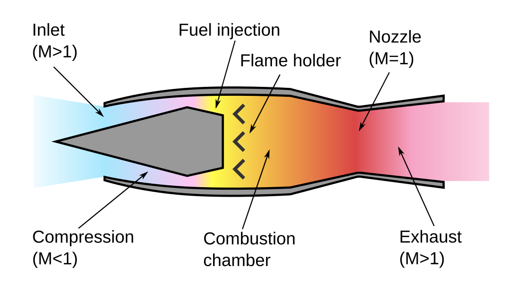

# Ramjet 
*Created on:* 2025-02-09  
*Tags:* #Ramjet
*Course:* [[Airbreathing Propulsion]]

---
## Definition

- It requires forward motion of the engine to provide air for combustion.
- They work most efficiently at speeds of $M=3$.
- Used for missiles which require a compact mechanism for high-speed such as missiles.

- It has no mechanical compressor or turbine.
- It consists of a diffuser, combustion chamber and a exhaust nozzle similar to a [[Turbojet Engine]].

