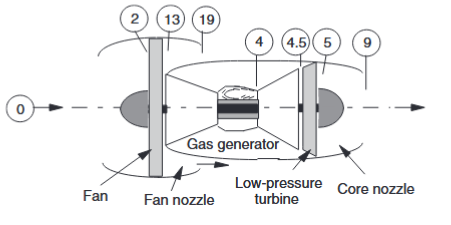

# Turbofan 
*Created on:* 2025-02-08  
*Tags:* #Turbofan
*Course:* [[Airbreathing Propulsion]]

---
## Definition

- A basic gas generator is followed by an additional turbine stage (s), which tap into the exhaust stream thermal energy to provide shaft power to a fan.

- The fan is a low-pressure compressor and driven by a low-pressure turbine.
- The bypass ratio is defined as the flow rate in the fan bypass duct to that of the gas generator.
$$
\alpha = \frac{\dot{m}_{bypass}}{\dot{m}_{core}}
$$
- The fan pressure ratio is given as 
$$
\pi_{f} = \frac{P_{t13}}{P_{t2}}
$$
- The fan exhaust stream may be separate from the so-called core stream and hence referred to as separate exhaust turbofan engine.
- It is possible to extend the fan duct and provide mixing of the fan and the core stream in a common exhaust nozzle.
- The adiabatic efficiency of the fan is defined as
$$
\eta_{f} = \frac{\Delta h_{t,isentropic}}{\Delta h_{t,actual}} = \frac{\pi_{f}^{(\gamma-1)/\gamma}-1}{\tau_{f}-1}
$$

- The power balance between the turbine and compressor now includes the fan, and written as
$$
\eta_{m}(\dot{m}_{0}+\dot{m}_{f})(h_{t4}-h_{t5}) = \dot{m}_{0}(h_{t3}-h_{t2}) + \alpha \dot{m}_{0}(h_{t13}-h_{t2})
$$

- The engine consists of two nozzles i.e. one for the fan flow and core flow. The total thrust is the sum of gross thrust achieved using both the nozzles.