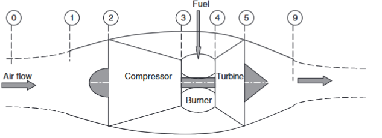
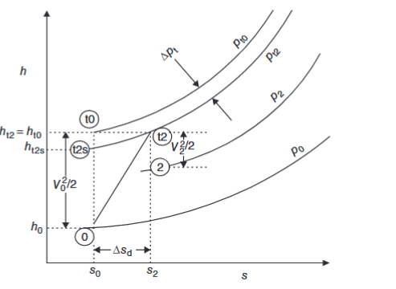
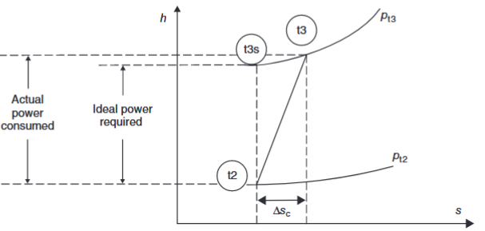
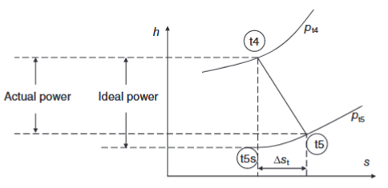
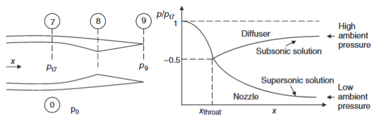
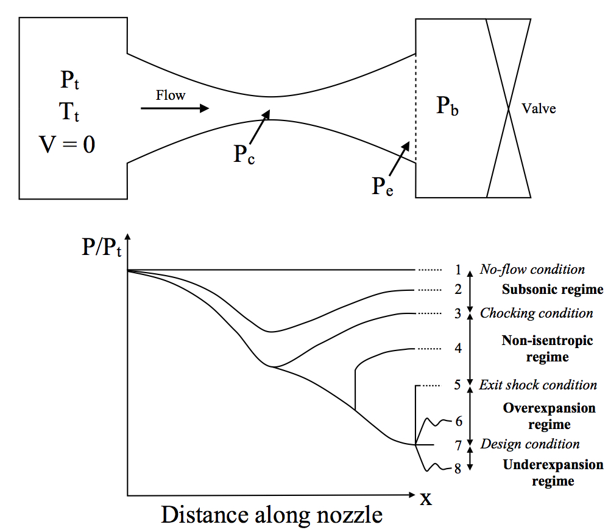
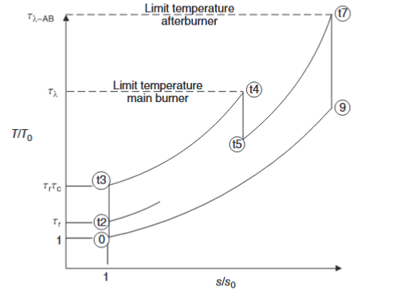

# Turbojet Engine 
*Created on:* 2025-02-08  
*Tags:* #Turbojet Engine
*Course:* [[Airbreathing Propulsion]]

---
## Definition

- It is [gas generator](Brayton%20Cycle.md) fitted with an inlet and exhaust system.
- The performance of a turbojet depends on the inlet and exhaust component efficiencies.

## Inlet

- The basic function of the inlet is to deliver the air to the compressor at the right Mach number $M_{2}$ and the right quality (low distortion).
- The subsonic compressors are designed for an axial Mach number of $M_{2}=0.5-0.6$.
- The inlet needs to decelerate the air for the compressor in case the flight Mach number is higher than 0.5 and 0.6.
- It is also known as a diffuser and associated with adverse pressure gradient which leads to flow separation.
- Designing a inlet without flow separation is the major objective.
- An ideal inlet provides isentropic compression of the captured flow.
- The entropy rise in an adiabatic process leads to a total pressure loss $\Delta p_{t}$ from the Gibbs equation.

- The inlet adiabatic efficiency is defined as
$$
\eta_{d} = \frac{h_{t2s} - h_{0}}{h_{t_{2}}-h_{0}} = \frac{(V^2/2)_{ideal}}{V_{0}^2/2}
$$
- The state $s$ represents the ideal state which would have been obtained through isentropic compression but in real-life adiabatic but not reversible due to wall friction.
- The efficiency represents the amount of energy lost as heat due to friction.
- The pressure is related as
$$
\frac{p_{t_{2}}}{p_{0}} = \left(1+\frac{\eta_{d}(\gamma-1)}{2}M_{0}^2\right)^{\gamma/\gamma-1} 
$$
- The inlet total pressure recovery factor is given as
$$
\pi_{d} = \frac{p_{t2}}{p_{t0}} = 1\, (\text{For isentropic compression})
$$

## Compressor

- The power delivered by the rotor spinning at angular speed $\omega$ is given as
$$
P = \tau \cdot \omega
$$
- The compressor is driven by the power extracted from the turbine.
- The flow is adiabatic since the energy transferred through the walls is extremely larger than the amount delivered by it.
- The pressure and temperature increase in the compressor is as given as
$$
\pi_{c} = \frac{p_{t3}}{p_{t2}}, \,\,\, \tau_{c} = \frac{T_{t3}}{T_{t2}}
$$

- The measure of irreversibility in a compressor is defined using
	- Adiabatic efficiency $\eta_{c}$
	- Polytropic efficiency $e_{e}$

- The adiabatic efficiency is defined as
$$
\eta_{c} = \frac{P_{ideal}}{P_{actual}} = \frac{h_{t3s}-h_{t2}}{h_{t3}-h_{t2}} = \frac{\pi_{c}^{(\gamma-1)/\gamma} -1}{\tau_{c}-1}
$$
- Polytropic efficiency is defined as 
$$
e_{c} = \frac{dh_{ts}}{dh_{t}}
$$
- It is also known as small stage efficiency and the adiabatic efficiency of a compressor with small pressure ratio or an individual stage.
$$
\tau_{c} = \pi_{c}^{(\gamma-1)/\gamma e_{c}}
$$
$$
\eta_{c} = \frac{\pi_{c}^{(\gamma-1)/\gamma}-1}{\pi_{c}^{(\gamma-1)/\gamma e_{c}}-1}
$$
- The adiabatic efficiency i.e. efficiency of the whole compressor is dependent on the efficiency of each single stage or the polytropic efficiency.
- $e_{c}$ is usually maintained constant in an engine.

## Combustion Chamber

- The air is mixed with the fuel and a chemical reaction ensues which is exothermic.
- The ideal burner operates at same total pressure i.e. $P_{t3} = P_{t4}$.
- Whereas in a real burner, the pressure drops due to irreversibility and 
$$
\pi_{b} <1
$$
- The energy balance applied to the combustion chamber gives
$$
\dot{m}_{0}h_{t3} + \dot{m_{f}}Q_{R}\eta_{b} = (\dot{m_{0}} + \dot{m}_{f})h_{t4}
$$
## Turbine

- It is involved with significant pressure drop called flow expansion.
- The flow expansion produces the necessary power for the compressor and the propulsive power for the aircraft.
- The first few stages (HPT) of the turbine are cooled due to the high temperature flow exiting the combustor.

- The adiabatic efficiency across the turbine is defined as
$$
\eta_{t} = \frac{h_{t4}-h_{t5}}{h_{t4}-h_{t5s}} = \frac{\Delta h_{t,actual}}{\Delta h_{t,isentropic}} = \frac{1-\tau_{t}}{1-\pi_{t}^{(\gamma-1)/\gamma}}
$$
- The small stage efficiency for the turbine is defined as
$$
e_{t} = \frac{dh_{t}}{dh_{ts}}
$$
- It is related to the adiabatic efficiency as
$$
\eta_{t} = \frac{1-\tau_{t}}{1-\tau_{t}^{1/e_{t}}}
$$
- Ideally, the compressor absorbs all the turbine shaft power i.e.
$$
P_{t} = P_{c} \implies (\dot{m_{0}} + \dot{m}_{f})(h_{t4}-h_{t_{5}}) = \dot{m}_{0}(h_{t3}-h_{t2}) 
$$
- The mechanical efficiency of the power transfer is given as
$$
P_{c} = \eta_{m}P_{t}
$$

## Nozzle

- The function of a nozzle is to accelerate the gas efficiently.
- The gross thrust is given as
$$
F_{g} = \dot{m}_{9}V_{9} + (p_{9}-p_{0})A_{9}
$$
- The real flows are considered as adiabatic.
- The maximum gross thrust is obtained for a perfectly expanded nozzle.
- The exit pressure is a direct function of the nozzle pressure ratio (NPR). 
$$
NPR = \frac{P_{t7}}{P_{0}}
$$
- For $NPR>NPR_{critical}$, the flow through nozzle is choked i.e. the throat velocity is sonic.
- $NPR_{critical} \approx 2$.

## Efficiency of the engine

- The thermal efficiency of a turbojet is given as
$$
\eta_{th} = 1- \frac{T_{0}}{T_{t3}}
$$
- The propulsive efficiency of the turbojet is given as
$$
\eta_{p} = \frac{2}{1+\left( \frac{V_{9}}{V_{0}} \right)}
$$
## Afterburner

- Helps in increase of thrust of an aircraft gas turbine engine.

- The pressure ratio across the afterburner is given as
$$
\pi_{AB} = \frac{P_{t7}}{P_t5}
$$
- The energy balance across the afterburner is given as
$$
(\dot{m}_{0}+\dot{m}_{f}+\dot{m}_{f,AB})h_{t7} - (\dot{m}_{0}+\dot{m}_{f})h_{t5} = \dot{m}_{f,AB}Q_{R,AB}\eta_{AB}
$$
