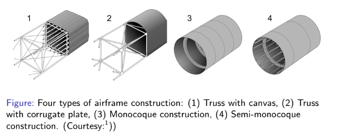

# Characteristics 
*Created on:* 2025-02-03  
*Tags:* #Characteristics
*Course:* [[]]

---
## Introduction

- Aircraft Materials: High Stiffness, High Strength and Light Weight
- Shell-like Structures
- Stiffened Shell Structures
- Aircraft structures more complicated than civil engineering structures.
- Assembly of thousands of parts.
- The shape and size of an aircraft structural component are usually determined based on non-structural considerations.
- Materials used: Aluminum and Titanium Alloys due to high stiffness to weight and strength to weight ratios.
- Composites are extensively used.

## Loads on the various aircraft components

- Axial Members
	- They are slender.
	- May buckle under compression.
- Shear Panel: 
	- Thin sheet of materials used to carry in-plane shear load
	- Can also be curved.
- Beam:
	- Structural member which can resist bending moment.
- Plate:
	- Upper and lower skins of the wing are thin plates supported by ribs and stiffness.
- Loads:
	- Axial
	- Bending
	- Torsional Load
