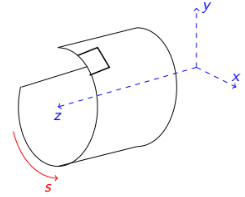

# Shear in Aircraft Structures 
*Created on:* 2025-02-03  
*Tags:* #Shear
*Course:* [[Aircraft Structures]]

---
## Definition

- Large transverse shear stress in thin walled beams.
- Assumptions:
- Shear stresses normal to the beam surface may be neglected since they are zero at each surface and the wall is thin.
- Normal and shear stresses on planes normal to the beam surface are constant across the thickness.
- Beam is of uniform section, so that the thickness may vary with distance around each section.
- S: Distance measured around the cross-section from some convenient origin.
- Thickness - t

- Shear stresses produced due to 
	- Shear and/or torsion of a closed section beam.
	- Shear of an open section beam.
- Shear flow $q = \tau t$ which is positive in the direction of increasing $s$.
- Balancing the forces in $z$ direction due to the action of normal and shear stresses, gives
$$
\frac{\partial q}{\partial s} + t \frac{\partial\sigma_{z}}{\partial z} = 0
$$
- Similarly for balancing the forces in $s$ direction, we get
$$
\frac{\partial q}{\partial z} + t \frac{\partial\sigma_{s}}{\partial s} = 0
$$
- The shear loads $S_{x}$ and $S_{y}$ are applied such that there is no twisting of the beam cross-section. This particular point is known as shear center.
- From the [[Bending]], we know the definition of $\sigma_{z}$ in terms of $M_{x}$ and $M_{y}$. Thus,
$$
\frac{\partial\sigma_{z}}{\partial z} = \frac{S_{x}I_{xx} - S_{y}I_{xy}}{I_{xx}I_{yy} - I_{xy}^2}x + \frac{S_{y}I_{yy} - S_{x}I_{xy}}{I_{xx}I_{yy} - I_{xy}^2}y
$$
- Substituting this and integrating from 0 to $s$, we get
$$
q_{s} = - \frac{S_{x}I_{xx} - S_{y}I_{xy}}{I_{xx}I_{yy} - I_{xy}^2}\int_{0}^s tx\,ds - \frac{S_{y}I_{yy} - S_{x}I_{xy}}{I_{xx}I_{yy} - I_{xy}^2}\int_{0}^s ty\,ds
$$

