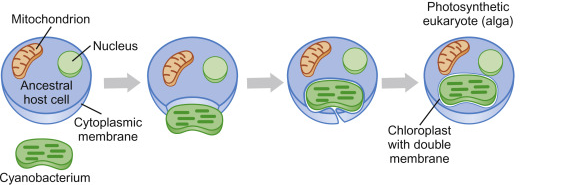

# Endosymbiotic theory 
*Created on:* 2024-12-05  
*Tags:* #endosymbiotictheory
*Course:* [[Astrobiology]]

---
## Definition

*Endosymbiotic theory* states that some of the current organelles present in [eukaryotes](Prokaryotes%20and%20Eukaryotes) were once a [prokaryotic](Prokaryotes%20and%20Eukaryotes) microbe @endosymbiotic.

- Ancestral eukaryotic cell were similar to an amoeba and ingested other organisms for nutrients. 
- *Mitochondria* reminiscent of *Purple bacteria* which were capable of aerobic respiration.
- *Chloroplasts* reminiscent of *Cyanobacteria* which were capable of photosynthesis.
- These were ingested by some ancestral eukaryotic cell and with time developed a symbiotic relationship with it. They lost their cell wall and much of DNA.
  

