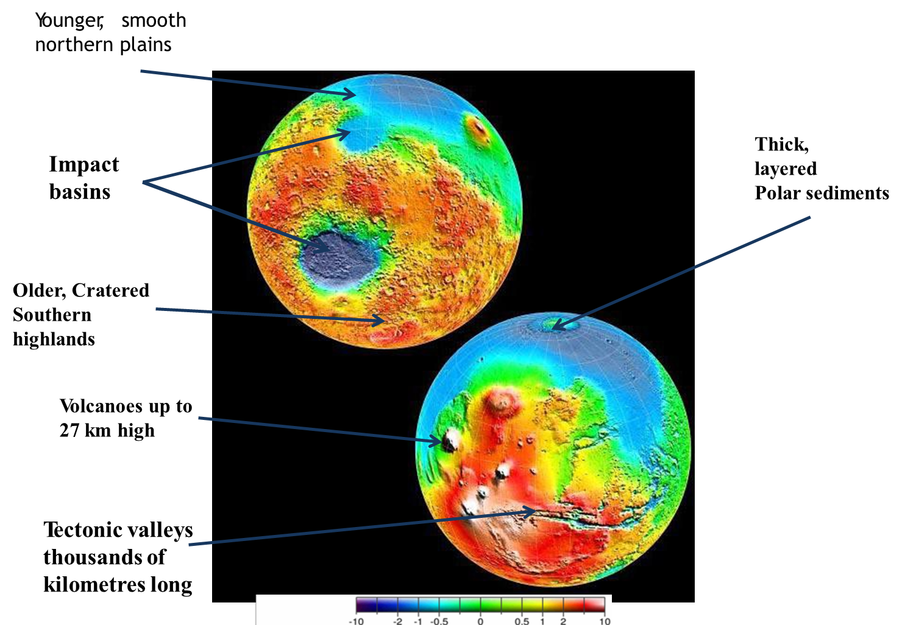

# Mars 
*Created on:* 2024-12-12 
*Tags:* #Mars
*Course:* [[Astrobiology]]

---
### Properties

- Red Planet
- Iron Oxide Dust
- Giant volcanoes
- Impact craters and large basins
- Deep system of canyons
- Mass Movements
- Presence of water

### Topography of Mars

- Wind streaks and dust storms present on Mars.
- Northern low lands were submerged under an ancient ocean.
- Largest volcano in the solar system is present in Mars.
- Largest canyon in the solar system present on Mars.

### Martian Atmosphere

- Primarily composed of carbon dioxide.
- Minor amounts of argon and nitrogen.
- Very thin.
- Loss of atmosphere due to solar winds.

### Evidences of Water on Mars

- The ejecta deposits of many Martian craters appear to have flowed over the surrounding surface like mudflows.
- Presence of runoff channels resembling those on Earth.
- Gullies have been seen on crater walls.
- Alluvial fans is a fan shaped deposit of sediment crossed and built up by streams. They are present on Mars.
- Presence of round pebbles known as conglomerate, which are formed from sharp rocks due to transportation through water.
- Delta formation.
- Presence of hydrogen on low-lying areas.
- Presence of clay, gypsum with requires aqueous environment.
- Glacial deposits.