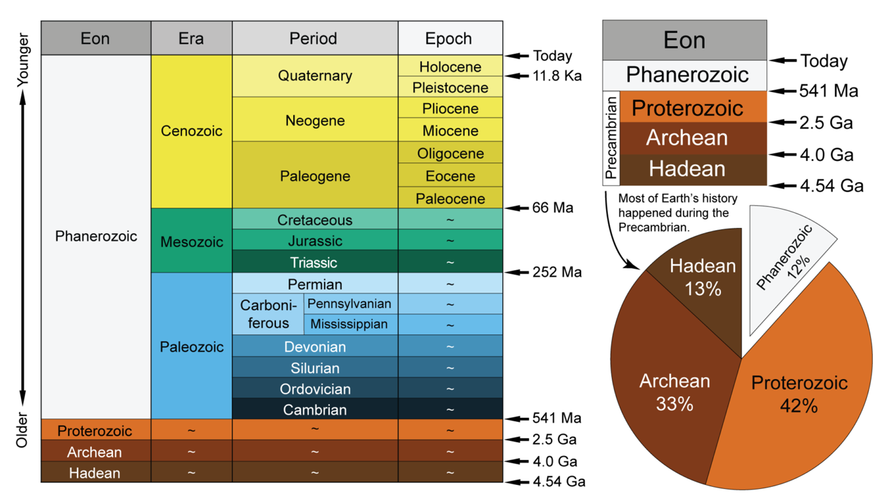

# Origin of Earth 
*Created on:* 2024-12-12  
*Tags:* #originofEarth
*Course:* [[Astrobiology]]

---

- *Accretion:* Planetesimals collided and merged to form protoplanets.
- *Differentiation:* Earth cooled and distinct layers within the earth were formed.
- *Formation of Moon:* A large body collied with the early earth separate a part of earth and moon was formed.
- *Development of Atmosphere:* 
	- The early atmosphere was primarily composed of volcanic gases, including water vapor, carbon dioxide, nitrogen, and sulfur compounds.
	- As Earth cooled, water vapor condensed to form oceans, leading to significant changes in atmospheric composition.
- *Emergence of Life*:
	- The earliest life forms, likely simple prokaryotic organisms, emerged around ~3.5 billion years ago in the oceans.
	- These organisms played a crucial role in altering the atmosphere, particularly through the process of photosynthesis, which introduced oxygen.
- *Geological Activity:* Earth has undergone continuous geological processes, such as plate tectonics, volcanism, and erosion, shaping its surface and influencing the evolution of life

*Geological Time Scale* is a system to describe the timing and relationships in Earth's history.

### Evolution of Atmosphere

**Primary Atmosphere**
- Volcanic Outgassing releases water vapor, carbon dioxide, carbon monoxide, methane, nitrogen, ammonia, and sulphur gases.
- Nitrogen built up in the atmosphere.
- Water vapor condensed to form the oceans as the Earth cooled.
- No oxygen in this phase.
- Rich in carbon dioxide.

**Secondary Atmosphere**
- Chemically active volatiles: H, C, N, O, S
- Primordial noble gases were present.
- Element that form non-volatile minerals: Mg, S, Fe.

**Present Atmosphere**
- Life in ocean started consuming the carbon dioxide and releasing oxygen in large amount for photosynthesis.
- Photochemical dissociation due to radiation broke water vapor into hydrogen and oxygen molecules.
- Great oxidation event took place.
- Carbon dioxide was locked in sedimentary rocks, fossil fuels and dissolved in oceans.

### Formation of Oceans
- Much water is from volcanic degassing
- Salts in ocean is derived from weathering and carried to the oceans by rivers.
- Part of the earth's water probably came from comets.

### Phosphorus

- All living organism require phosphorus for synthesis of nucleic acids, phospholipids, ATP, etc.
- Essential in prebiotic chemistry.
- Weathering of phosphate minerals was an important source.
- Phosphorus minerals accumulated in Earth's crust due to tectonic and volcanic activites,

