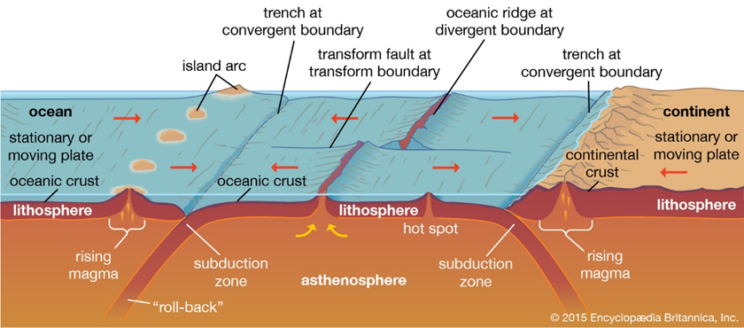
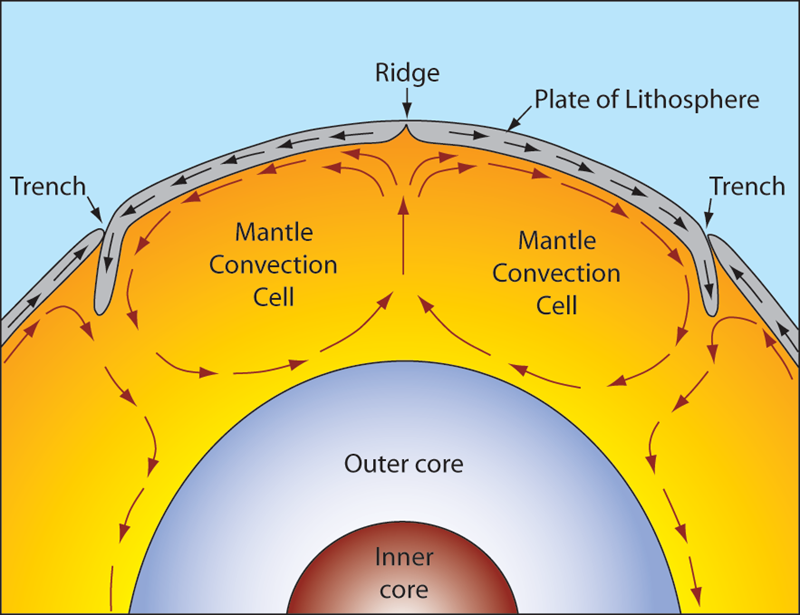
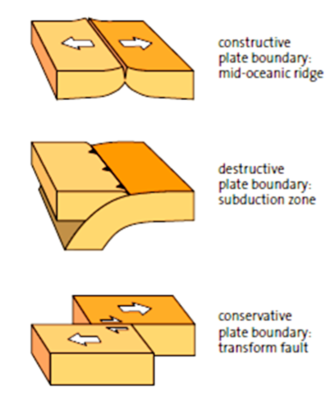
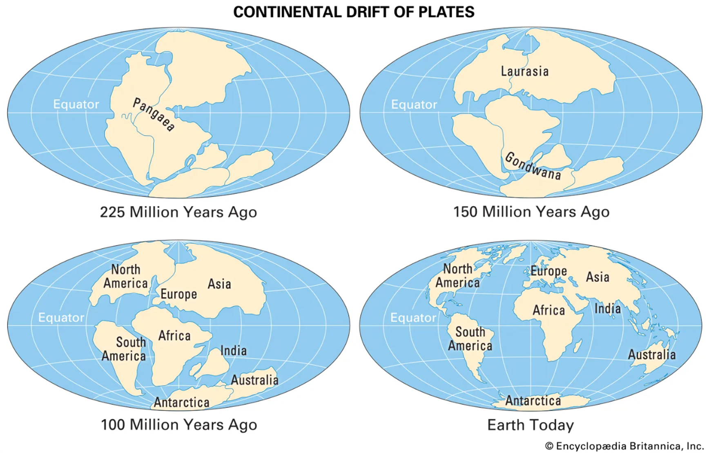

# Plate Tectonics 
*Created on:* 2024-12-12  
*Tags:* #platetectonics
*Course:* [[Astrobiology]]

---
## Definition
*The earth's crust and upper mantle are broken into section called plates which around on the top of the mantle like rafts.*

There are 20 crustal plates among them 7 are major plates.

### Types of Plates

- *Oceanic Plates:* Plates below the ocean
	- Thin (5-7 KM)
	- Higher density
	- Predominantly Mafic (Si Poor, rich in Fe, Mg, Ca)
- *Continental Plates:* Plates below the continents.
	- Thick
	- Lower Density
	- Predominantly Felsic (Si rich, poor in Fe, Mg, Ca)

### Plate Movements
- In the mantle hot material rises towards the lithosphere.
- It cools back and sinks down. The cycle form a large *convection cell*.
- This convection cell is causing the plate movement and creates a stress in the crust known as *Tectonic Forces*

### Plate Boundaries

- *Divergent plate boundary*
	- They create empty space where upper mantle is exposed and magma flows in to create more plate known as Seafloor Spreading.
	- Used to determine the magnetic polarities of the earth.
	- Newer ocean floor near the ridges.
- *Convergent plate boundary*
	- Boundaries between two plates that are colliding.
	- *Continental Plate v/s Continental Plate* forms a folded and thrust faulted mountains.
	- *Ocean Plate v/s Continental Plate* forms a subduction zone (trench) where the more dense plate slides under the less dense plate. Also forms a volcanic arc.
	- *Ocean Plate v/s Ocean Plate* forms a trench and an island arc. 
- *Transform plate boundary*

### Continental Drift Theory
