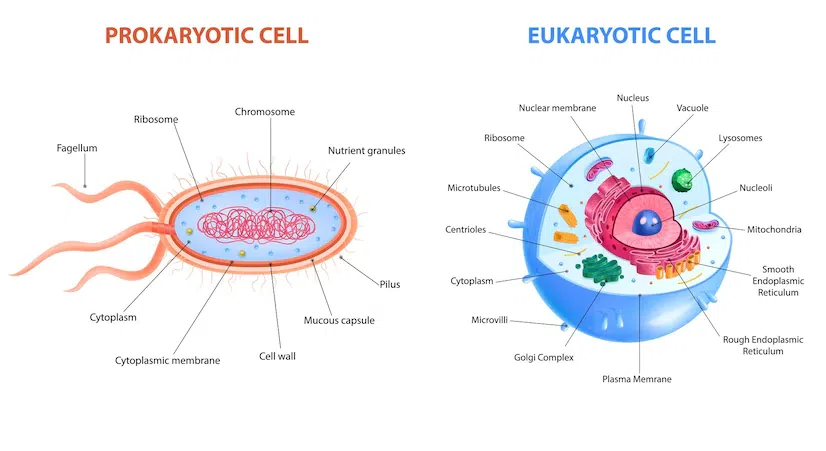

# Prokaryotes and Eukaryotes  
*Created on:* 2024-12-05  
*Tags:* #prokaryotes #eukaryotes
*Course:* [[Astrobiology]]

---
## Definition
*Prokaryote* is a single-celled organism whose cell lacks nuclear membrane and other membrane bound organelles.

*Eukaryote* is a group of organisms whose cell have membrane bound nucleus and other organelles. They can be unicellular and multicellular.

### Similarities

1. Genetic material for both is *DNA*.
2. Existence of ribosome in both, which produces proteins.
3. Existence of cell membrane in both.
4. Cytoplasm exists in both.
5. Cell wall is present in both.

### Differences

|                Prokaryotes                |                 Eukaryotes                  |
| :---------------------------------------: | :-----------------------------------------: |
|            No proper nucleus.             |     A proper membrane bounded nucleus.      |
| Genetic material is present in cytoplasm. | Genetic material is present inside nucleus. |
|          No specific organelles.          |        Membrane bounded organelles.         |

