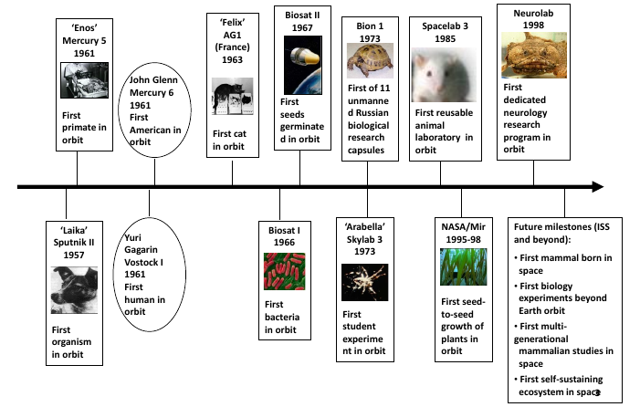

# Space Biology
*Created on:* 2024-12-07  
*Tags:* #SpaceBiology
*Course:* [[Astrobiology]]

---
## Definition

*Six major environmental factors in space*
- Gravity
- Micrometeoroids and space junk
- Atmosphere
- Radiation
- Vacuum
- Charged Particles
  
*Microgravity:* Any place in space where perceived gravity is smaller than on Earth.

**Organisms studied in Space**

1. *Bacteria*
2. *Invertebrates:* Cricket, Spider, Snail, Fruit Fly, Wasp, Beetle, Amoeba
3. *Vertebrates:* Dog, Cat, Human, Mouse, Rabbit, Monkey
4. *Birds:* Quail, Chicken
5. *Aquatic Species:* Sea urchin, jelly fish, toadfish, frog, swordtail fish.

**Space biology focus on the ISS**

- To understand at cell and molecular level
- Understand underlying biochemical and molecular mechanisms
- Model organisms used for study.
	- Well-characterized
	- Genetically sequenced
	- Microbes, Round worm, Fruit fly, Rodent		  

**Effect of Spaceflight on Astronaut's health**

- Radiation Risk
- Puffy Face
- Cardiovascular risk
- Bone loss
- Immune system decrement
- Muscle Loss
- Impaired *Vestibular System* (Sense of Balance)
- Visual Impairments
  
**Microbial response to space environment**

Three microbial *phenotypes* (Observable characteristic change due to interaction of its genotype with environment) will change in space

- *Growth:* Bacillus safensis grew 60% better in space than on Earth
- *Antibiotic resistance:* Occurs due to mutation in some, they survive and spread, later they may transfer this resistance to other species.
- *Virulence:* Harmfulness of any microbe

**STS-115 S.typhimurium experiments**

- Change in group of genes which help the bacteria adapt to space environment.
- Decrease in time of death of mice in space (due to bacteria).
- Increased mortality of mice in space (due to bacteria).
- Decreased LD50 (Dosage required to kill 50% of the population) in space. 
- Increased aggregation of cells in space.

**Fruit Flies for Spaceflight studies**

- Basic biology is highly conserved.
- 77% disease gene similarity.
- Smaller size, easy to culture and inexpensive.
- Low requirements for volume and crew time.
- Short life-cycle allows for multiple generations during space flight studies.
- Study of development of kidney stone model in fruit flies with varied concentration of salts.

**Human response to Space**

- Long duration missions are rare but in future long duration missions will take humans to Mars and beyond.
- Comprehensive studies are needed to assess impact of long-duration spaceflight on human body, brain and overall physiology.
- Year-long twins study. 
	- Genetically identical twins
	- On was on ISS and other on ground.

