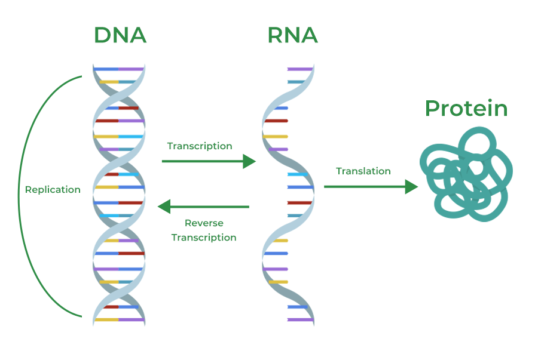
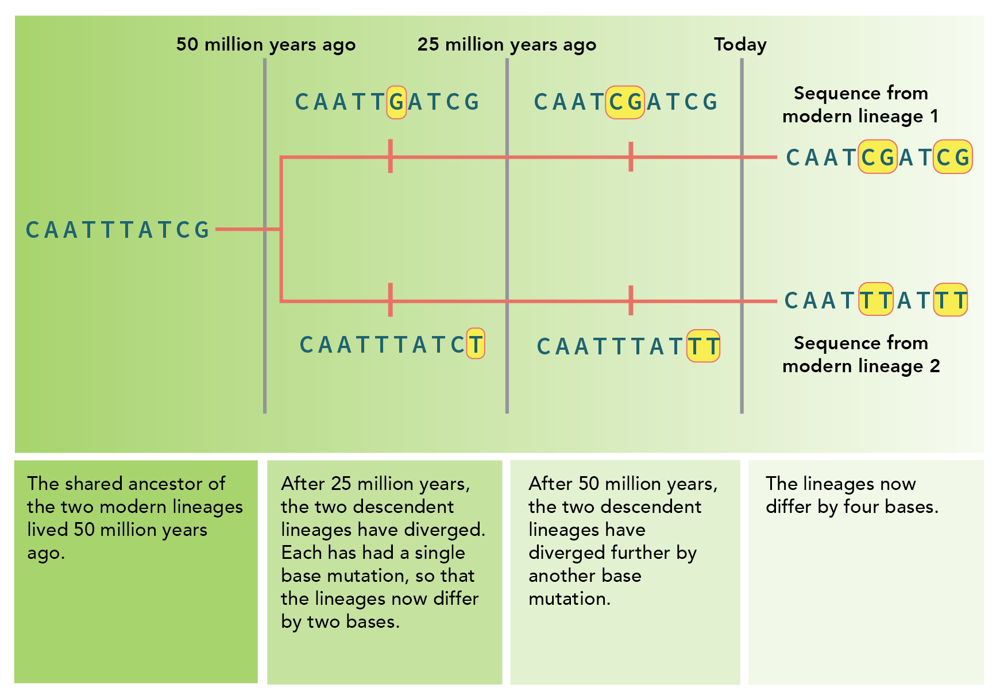

# Tree of Life
*Created on:* 2024-12-12  
*Tags:* #TreeofLife
*Course:* [[Astrobiology]]

---
## Definition

*Earth's wealth of species in the context of evolution.*

- All life on earth is a part of a single phylogenetic tree.
- A common ancestor called LUCA (Doncic).
- Based on similarities and differences in physical and genetic features.
- Dr. Carl Woose caused a paradigm shift in ToL from 2 branches to 3 branches.

*Ecology:* The whole science of the relations of the organism to the environment including in the broad sense all the conditions of existence.

*Barcode:* Way to identify and measure the similarities and differences between organisms e.g. genetic code.

**Central Dogma**

*Genome:* Entire genetic code of an organism.

Functions of Genome:
1. *Replication:*
	1. DNA to DNA
	2. Happens during binary fission.
2. *Transcription*
	1. DNA to RNA
	2. Happens inside nucleus
3. *Translation*
	1. RNA to Protein
	2. Ribosomes work.
	3. Happens inside cytoplasm.
	4. Only mRNA (Messenger RNA) becomes protein through translation.

### RNA World Hypothesis

- Life on earth began with a simple RNA molecule that could copy itself.
- RNA molecule which acts as catalyst/enzyme is known as ribozyme.
- They interact with other RNA molecules to form nucleotides and later DNA.
- Ribosome is a type of ribozyme.

### Pre-RNA world

- Before RNA world.
- Polymers that resemble RNA but are chemically simpler.
- *PNA:* Peptide Nucleic Acid
- *pRNA:* pyranose RNA (6-Membered Ring)

### Emergence of DNA world

- Protein based enzymes can copy RNA to produce molecules of complementary DNA.
- Enzymes can promote the production of DNA nucleotides from RNA nucleotides.

### Molecular clock

It is a timeline of evolution of any organism and used to build the phylogenetic tree.

- Number of base pair changes in a stable but changing gene over a period of time gives an estimate of the mutation rate.
- From the knowledge of a known evolutionary event and the current generations, the phylogenetic tree can be constructed for the intermediate species.
- Example of molecular clocks, mitochondrial DNA, 16srRNA (in bacteria).
 

In the above image, the two modern species originated from a single species about 50 million years ago.