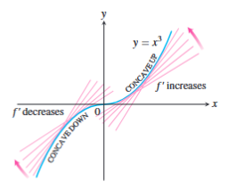

# Maxima and Minima 
*Created on:* 2024-12-23 
*Tags:* #Maxima #Minima
*Course:* [[Calculus]]

---
## Definition

A function has an *absolute maximum* value on $D$ at a point $c$ if
$$
f(x) \leq f(c)\,\,\, \text{for all x in D}
$$
And an *absolute minima* value of $D$ at c if
$$
f(x) \geq f(c)\,\,\, \text{for all x in D}
$$

The maxima and minima are collectively known as extrema. Absolute extrema are also called *global extrema*.

*Local extrema* is a maxima and minima in some open interval containing that point.

*Critical Point:* An interior point of the domain of a function $f$ where $f\,'$ is zero or undefined.
### Extreme Value Theorem

If $f$ is continuous on a closed interval $[a,b]$, then $f$ attains both an absolute maxima and minima in $[a,b]$.

## First Derivative Test

*Monotonic functions*: Functions which either increase or decrease throughout the domain is known as a monotonic function.

If $x_{1}$ and $x_{2}$ are any two points in the domain,
$$
\begin{gathered}
f(x_{1}) < f(x_{2})\,\,\text{whenever}\,\, x_{1}<x_{2}\implies \text{Increasing}\\
f(x_{1}) > f(x_{2})\,\,\text{whenever}\,\, x_{1}<x_{2}\implies \text{Decreasing}\\
\end{gathered}
$$ 
If $f\,'(x)>0$ at each point $x \in(a,b)$, then $f$ is monotonically increasing, otherwise if $f\,'(x)<0$, then $f$ is monotonically decreasing.

1. If $f\,'$ changes from negative to positive at $c$, then $f$ has a local minimum at $c$.
2. If $f\,'$ changes from positive to negative at $c$, then $f$ has a local maximum at $c$.

## Second Derivative Test

Suppose $f''$ is continuous on an open interval that contains $x=c$,
1. If $f'(c)= 0$ and $f''(c)>0$, the function has a local minima at c.
2. If $f'(c)= 0$ and $f''(c)<0$, the function has a local maxima at c.
3. If $f'(c)= 0$ and $f''(c)=0$, the test fails.

The extreme values of $f(x,y)$ can occur only at
1. Boundary points of the domain of f.
2. Critical points i.e. where $f_{x}=f_{y}=0$.

Second derivative test for $f(x,y)$
1. $f_{x x}<0$ and $f_{x x}f_{y y} - f_{xy}^2 >0$ at $(a, b) \implies$ Local Minima
2. $f_{x x}>0$ and $f_{x x}f_{y y} - f_{xy}^2 >0$ at $(a, b) \implies$ Local Maxima 
3. $f_{x x}f_{y y} - f_{xy}^2 <0$ at $(a, b) \implies$ Saddle Point 
4. $f_{x x}f_{y y} - f_{xy}^2 =0$ at $(a, b) \implies$ Test is inconclusive   

## Concavity

The graph of a differentiable function $y=f(x)$ is
1. **concave up** on an open interval if $f\,'$ is increasing, i.e. $f''>0$.
2. **concave down** on an open interval if $f\,'$ is decreasing, i.e. $f''<0$.

A point where the graph of a function has a tangent line and where the concavity changes is a *point of inflection*.