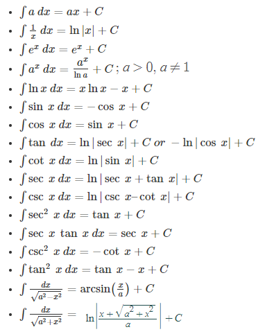

# Integration 
*Created on:* 2024-12-23  
*Tags:* #Integration
*Course:* [[Calculus]]

---
## Definition

The function $F$ is an antiderivative of $f$ on an interval $I$ if $F'(x) = f(x)$ for all $x$ in $I$.

The set of all antiderivatives of $f$ is the *indefinite integral* of $f$ with respect to $x$, denoted by
$$
\int f(x)\,\,dx
$$
### Standard Integrals

## Definite Integral

A number $I$ is the definite integral of $f$ over $[a,b]$ and that $I$ is the limit of the Riemann sums $\left|\sum_{k=1}^{n} f(c_{k})-I\,\right|<\epsilon$.
$$
\int_{a}^b f(x)\,dx = I
$$

If $y=f(x)$ is nonnegative and integrable over a closed interval $[a,b]$, then the area under the curve $y=f(x)$ over $[a,b]$ is the integral of $f$ from $a$ to $b$,
$$
A = \int_{a}^b f(x)\,dx
$$
### Mean Value Theorem for Definite Integral

If $f$ is continuous on $[a,b]$, then at some point $c$ in $[a,b]$,
$$
f(c) = \frac{1}{b-a} \int_{b}^a f(x)\,dx
$$

### Fundamental Theorem of Calculus

If $f$ is continuous on $[a,b]$ then $F(x) = \int_{a}^x f(t)\,dt$ is continuous on $[a,b]$ and differentiable on $(a,b)$ and its derivative is $f(x)$:
$$
F'(x) = \frac{d}{dx}\int_{a}^x f(t)\,dt = f(x)
$$
$$
\int_{b}^a f(x)\,dx = F(b)-F(a)
$$
