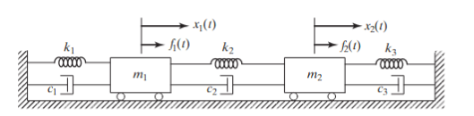

# 2-DOF Systems 
*Created on:* 2025-02-03  
*Tags:* #2-DOFSystems
*Course:* [[Dynamics]]

---
## Definition

- Degree of Freedom = Number of Mass x Number of independent directions of movement.
- A simple 2-DOF system is composed of two masses connected through springs with the wall and between themselves.

- For positive $x_{1}$ and $x_{2}$, spring 1, damper 1, spring 2 and damper 2 are in tension.
- Whereas spring 3 and damper 3 are in compression.
- The equation of motion for the system is given as
$$
\begin{gathered}
m_{1}\ddot{x_{1}} = - c_{1}\dot{x_{1}} + c_{2}(\dot{x_{2}}- \dot{x_{1}}) -k_{1}x_{1} + k_{2}(x_{2}-x_{1}) + f_{1}\\
m_{2}\ddot{x_{2}} = - c_{2}(\dot{x_{2}}-\dot{x_{1}}) - c_{3}\dot{x_{2}} - k_{2}(x_{2}-x_{1}) -k_{3}x_{2} + f_{2}\\
\end{gathered}
$$
- The EOM can be rearranged as the following
$$
\begin{gathered}
m_{1}\ddot{x_{1}}  + (c_{1}+c_{2})\dot{x_{1}} - c_{2}\dot{x_{2}} +(k_{1}+k_{2})x_{1} - k_{2}x_{2} = f_{1}\\
m_{2}\ddot{x_{2}} + (c_{2}+c_{3})\dot{x_{2}} -c_{2}\dot{x_{1}} + (k_{2}+k_{3})x_{2}-k_{2}x_{1} = f_{2}\\
\end{gathered}
$$
- The system can be written as matrix equation.

$$
[m] = \begin{bmatrix}
m_{1} & 0 \\
0 & m_{2}
\end{bmatrix}
$$
$$
[c] = 
\begin{bmatrix}
c_{1}+c_{2} & -c_{2} \\
-c_{2} & c_{2}+c_{3}
\end{bmatrix}
$$
$$
[k] = 
\begin{bmatrix}
k_{1}+k_{2} & -k_{2} \\
-k_{2} & k_{2}+k_{3}
\end{bmatrix}
$$
$$
[m]\,\ddot{\vec{x}}(t) + [c]\,\dot{\vec{x}}(t) + [k]\,\vec{x}(t) = \vec{f}(t)
$$

## Free vibration of an undamped system

- The governing system of differential equation becomes
$$
[m]\,\ddot{\vec{x}}(t) + [k]\,\vec{x}(t) = 0
$$
- We are interested in understanding the motion of the blocks with same frequency and phase angle but with different amplitudes. Hence, the solution is taken as
$$
\begin{gathered}
x_{1}(t) = X_{1} \cos(\omega t+\phi)\\
x_{2}(t) = X_{2} \cos(\omega t+\phi)
\end{gathered}
$$

- Substituting the solution and finding the determinant of the resultant matrix, we get the frequency or characteristic equation. 
- The solution of the equation yields two frequencies which are the natural frequencies of the system.
- Putting the value of $\omega = \omega_{1}$ and $\omega=\omega_{2}$, we get the first and second mode of the system.

