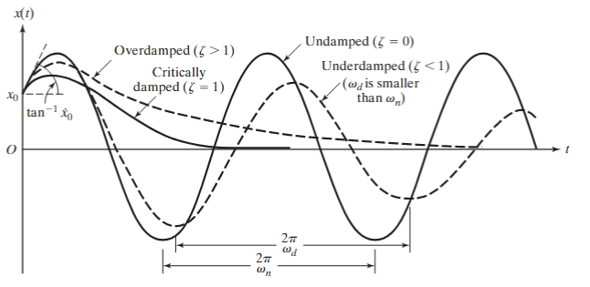
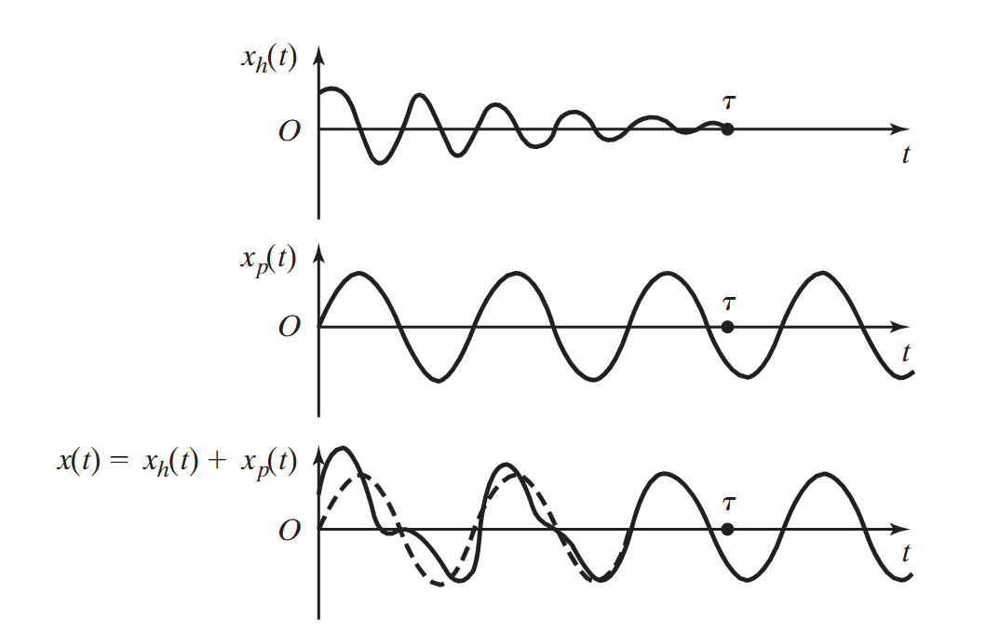
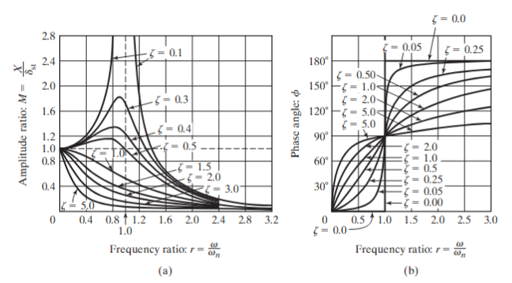

# Single-degree System 
*Created on:* 2025-02-01  
*Tags:* #SingleDegreeSystem
*Course:* [[Dynamics]]

---
## Definition

- A system with single degree of freedom.
- The simplest system is a spring-mass system.

## Free Vibration

- No external force is applied on the mass.
- The motion results from the initial disturbance is known as free-vibration.
- It can be damped/undamped.

## Undamped Free Vibration

- A spring-mass system is initially disturbed and the motion is observed.
- The mass of the body is $m$.
- The spring constant of the spring is $k$.
- The motion can be written as
$$
m\ddot{x} + kx = 0
$$
- This is a homogenous second-order ODE where $a=1, b=0$ and $c=\frac{k}{m}$. The value of $D = -\frac{4k}{m}$. 
- Thus, the solution of the equation is in the form
$$
x(t) = A_{1}\cos(\omega_{n}t) +A_{2}\sin(\omega_{n}t)
$$
- $\omega_{n}$ is the natural frequency of the system and equal to the root of the ratio of k and m.
$$
\omega_{n} = \sqrt{ \frac{k}{m} }
$$
- Putting the boundary conditions, we get
$$
x(t) = x_{0}\cos(\omega_{n}t) + \frac{\dot{x_{0}}}{\omega_{n}}\sin (\omega_{n}t)
$$
- This is a harmonic motion and known as a harmonic oscillator.

## Damped Free Vibration

- The viscous damping force $F$ is proportional to the velocity $\dot{x}$.
- The equation of motion can be written as
$$
m\ddot{x} + c\dot{x}+kx = 0
$$
- This is a homogenous second-order ODE.
- The general solution of ODE is 
$$
x(t) = C_{1}e^{s_{1}t} + C_{2}e^{s_{2}t}
$$
- Where 
$$
s_{1,2} = \frac{-c \pm \sqrt{ c^2 - 4mk}}{2m}
$$
- The system is critically damped when
$$
\left( \frac{c_{c}}{2m} \right)^2 - \frac{k}{m} = 0
$$
- The damping ratio is the ratio between damping factor and critical damping factor
$$
\zeta = \frac{c}{c_{c}} = \frac{c}{2\omega_{n}m} = \frac{c}{2\sqrt{ km }} 
$$
- The value of $s_{1,2}$ can be written as
$$
s_{1,2} = (-\zeta \pm \sqrt{ \zeta^2 -1 })\omega_{n}
$$

- The system is underdamped if $\zeta<0$, the system is critically damped for $\zeta=1$ and overdamped for $\zeta>1$.
- The frequency of oscillation of the damped system is given as
$$
\omega_{d} = \sqrt{1-\zeta^2 }\,\omega_{n}
$$

- A critically damped system will return to its equilibrium position at earliest.

## Forced Vibrations

- A damped spring-mass system is driven with a force $F(t)$.
- The equation of motion is a non-homogenous second-order ODE
$$
m\ddot{x} + c\dot{x} + kx = F(t)
$$

## Undamped System under Harmonic Force

- The governing ODE is
$$
m\ddot{x} + kx = F_{0}\cos(\omega t)
$$
- The homogenous solution $x_{h}(t)$ is already known
$$
x_{h}(t) = C_{1}\cos(\omega_{n} t) + C_{2}\sin(\omega_{n} t)
$$
- The exciting force is harmonic, hence the particular solution is assumed to a harmonic function oscillating with the same frequency
$$
x_{p}(t) = X\cos(\omega t)
$$
- Substitution of $x_{p}(t)$ in to the ODE, we get
$$
X = \frac{F_{0}}{k - m\omega^2} = \frac{\delta_{st}}{1-\left( \frac{\omega}{\omega_{n}} \right)^2}
$$
- $\delta_{st}$ is the static deflection of the mass under a force $F_{0}$.
- The total solution is 
$$
x(t) = C_{1}\cos(\omega_{n}t) + C_{2}\sin(\omega_{n}t) + \frac{F_{0}}{k-m\omega^2}\,\cos(\omega t)
$$
- Putting the initial conditions, we get
$$
C_{1} = x_{0} - \frac{F_{0}}{k-m\omega^2},\,\,\, C_{2} = \frac{\dot{x_{0}}}{\omega_{n}}
$$

- The quantity $\frac{X}{\delta_{st}}$ is known as amplification/magnification factor
- Case 1: $0<\frac{\omega}{\omega_{n}}<1$, the response is in phase with the external force.
- Case 2: $\frac{\omega}{\omega_{n}}>1$, the response is out of phase with the external force.
- Case 3: $\frac{\omega}{\omega_{n}}=1$, the amplitude $X$ becomes infinite and the response blows up. This is known as resonance.

- If the forcing frequency $\omega$ is close to the natural frequency $\omega_{n}$ but not equal, a phenomenon known as beating occurs.
- The amplitude builds up and then diminishes in a regular pattern.

## Damped System under Harmonic Force

- The governing ODE is given as
$$
m\ddot{x} + c\dot{x} + kx = F_{0}\cos(\omega t)
$$
- The particular solution is also expected to be harmonic
$$
x_{p}(t) = X\cos(\omega t - \phi)
$$
- $X$ is the amplitude and $\phi$ is the phase angle.
- Substitution of particular solution and equating the coefficients, we get
$$
X = \frac{F_{0}}{\sqrt{(k-m\omega^2)^2 + c^2\omega^2}}
$$
$$
\phi = \tan^{-1} \left( \frac{c\omega}{k-m\omega^2} \right)
$$
- The magnification factor is given as
$$
\frac{X}{\delta_{st}} = \frac{1}{\sqrt{ (1-r^2)^2 + (2\zeta r)^2}}
$$
Where $r=\frac{\omega}{\omega_{n}}$

- Any amount of damping reduces the magnification factor (M) for all the values of forcing frequency.

