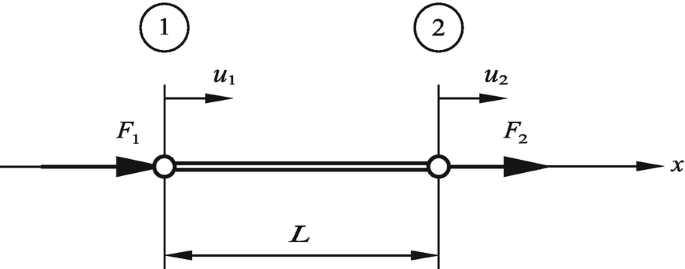
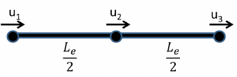

# 1D Bar Elements  
*Created on:* 2024-12-03
*Tags:* #1dBarElements #linearbar #quadraticbar #hrefinement #prefinement
*Course:* [[FEM]]

---
## Definition
*Generic form of FE equations for a 1D Bar element are*

$$
u'\,(x) = [N]\,\{\delta\}^e
$$
$$
\varepsilon_{x} = [B]\,\{\delta\}^e
$$
$$
[k]^e = \int\,[B]^T\, [B]\, EA\, dx
$$
$$
\{f\}^e = \int [N]^T\,q\,dx + \sum\,[N]_{i}^T\,P_{i}
$$
$$
\boxed{[k]^e\,\{\delta\}^e= [F]^e}
$$

### Linear Bar Element

*Displacement at any point within the element is interpolated from two nodes using shape functions.*

$$
[N]^T = 
\begin{bmatrix}
N_{1} & N_{2}\\
\end{bmatrix}
$$
Where,
$$
N_{1} = (1-\frac{x}{l})
$$
$$
N_{2} = \frac{x}{l}
$$

**H-Refinement**
- Increasing the number of elements in each iteration
- Higher inaccuracies in the value of stress as compared to the displacements
- Stress depends on the interpolation function along with the number of nodes.
- Stress at a node is the average of values surrounding the nodes.

### Quadratic Bar Element

*Displacement at any point within the element is interpolated from three nodes using shape functions.*

$$
[N]^T = 
\begin{bmatrix}
N_{1} & N_{2} & N_{3}\\
\end{bmatrix}
$$
Where,
$$
N_{1} = \left( 1-\frac{3x}{l} + \frac{2x^2}{l^2} \right)
$$
$$
N_{2} = \left(\frac{-x}{l} + \frac{2x^2}{l^2}\right)
$$
$$
N_{3} = \left(\frac{4x}{l} - \frac{4x^2}{l^2}\right)
$$
**P-refinement**
It refers to increasing the order of the polynomial fitted inside the bar element, example switching from linear bar to quadratic bar.

---
## Derivation

The strain energy,
$$
U^e = \frac{1}{2} AE \int_{0}^l \{\delta\}^{e^T}\,[B]^T\,[B]\ \{\delta\}^{e}\,dx
$$

Potential due to external forces,
$$
V^e = -\int \{\delta\}^{e^T}\,[N]^T\,dx - \sum\{\delta\}^{e^T}\,[N]^T_{i}\,P_{i} 
$$

Total potential energy of the element
$$
\Pi^e = U^e + V^e
$$
$$
\Pi_{e} = \frac{1}{2} \{\delta\}^{e^T}\,[K]\ \{\delta\}^{e} - \{\delta\}^{e^T}\{f\}^e
$$
Total potential energy,
$$
\Pi = \sum^N_{1} \Pi_{e}
$$
Using principal of total stationary potential
$$
\frac{\partial{\Pi}}{\partial{\{\delta\}^{T}}} = 0
$$
$$
[k]\,\{\delta\}= [F]
$$
