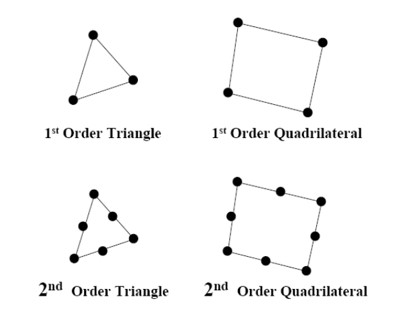

# 2D Elements 
*Created on:* 2024-12-03  
*Tags:* #2DElements #CST #QuadElement
*Course:* [[FEM]]

---
## Definition
*There are four types of elements*
- [[Three-noded Triangle]] (Tri3)
- [[Six-noded Triangle]] (Tri6)
- [[Four-noded Quadrilateral]] (Quad4)
- [[Eight-noded Quadrilateral]] (Quad8)

*2-DOF/Node* (u, v) for structural mechanics
*1-DOF/Node* (T) for thermal problems.

