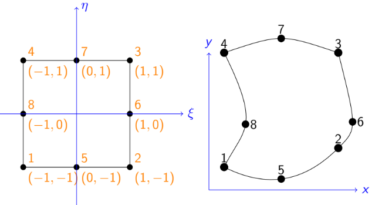
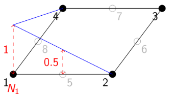

# Eight-noded quadrilateral 
*Created on:* 2024-12-03  
*Tags:* #quad8
*Course:* [[FEM]]

---
## Definition
*The corners nodes of a quadrilateral are supplemented by nodes at the center of each edge.*

Using [[Natural Coordinates]], the shape functions of mid-nodes can be found as
$$
\begin{array}{c}
	{{N_{5}=\displaystyle\left(\frac{1}{2}\right)\left(1-\xi^{2}\right)\left(1-\eta\right)}} \\
	{{N_{6}=\displaystyle\left(\frac{1}{2}\right)\left(1+\xi\right)\left(1-\eta^{2}\right)}} \\
	{{N_{7}=\displaystyle\left(\frac{1}{2}\right)\left(1-\xi^{2}\right)\left(1+\eta\right)}} \\
	{{N_{8}=\displaystyle\left(\frac{1}{2}\right)\left(1-\xi\right)\left(1-\eta^{2}\right)}}
\end{array}
$$

Now, the corner nodes are found by subtracting the contribution of shape function of mid nodes from the shape function of corresponding node from [[Four-noded Quadrilateral]].

$$
\displaystyle N_{1,8-Node} = N_{1,4-Node} - 0.5N_{5} - 0.5N_{8}
$$

Thus, 

$$
\begin{array}{c}
	N_{1}=\displaystyle\frac{1}{4}(1-\xi)(1-\eta)(-1-\xi-\eta) \\
	N_{2}=\displaystyle\frac{1}{4}(1+\xi)(1-\eta)(-1+\xi-\eta) \\
	N_{3}=\displaystyle\frac{1}{4}(1+\xi)(1+\eta)(-1+\xi+\eta) \\
	N_{4}=\displaystyle\frac{1}{4}(1-\xi)(1+\eta)(-1-\xi+\eta)
\end{array}
$$