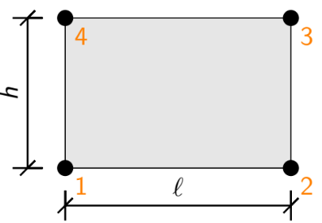
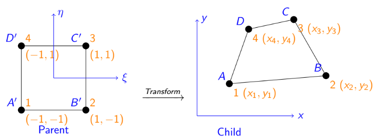

# Four-noded rectangular elements 
*Created on:* 2024-12-03  
*Tags:* #Quad4
*Course:* [[FEM]]

---
## Definition

$$
T(x,y) = c_{0} + c_{1}x + c_{2}y + c_{3}xy
$$
$$
T(x,y) = N_{1}T_{1} + N_{2}T_{2} + N_{3}T_{3} + N_{4}T_{4}
$$

Where,
$$
N_{1} = 1 - \frac{x}{l} - \frac{y}{h} + \frac{xy}{lh}
$$
$$
N_{2} = \frac{x}{l} - \frac{xy}{lh}
$$
$$
N_{3} = \frac{xy}{lh}
$$
$$
N_{4} = \frac{y}{h} - \frac{xy}{lh}
$$

*Quad4*  is a bilinear element i.e. it is linear along both $x$ and $y$.

Using [[Natural Coordinates]],

- $N_{1}$ = SF x (Eqn of line 2-3) x (Eqn of line 3-4)
- $N_2$ = SF x (Eqn of line 1-4) x (Eqn of line 3-4)
- $N_{3}$ = SF x (Eqn of line 1-4) x (Eqn of line 1-2)
- $N_{4}$ = SF x (Eqn of line 2-3) x (Eqn of line 1-2)

Solving the above we get,

$$
[N] = \frac{1}{4} 
\begin{Bmatrix}
(\zeta-1)(\eta-1) \\
(\zeta+1)(1-\eta) \\
(\zeta+1)(\eta+1) \\
(1-\zeta)(\eta+1)
\end{Bmatrix}
$$