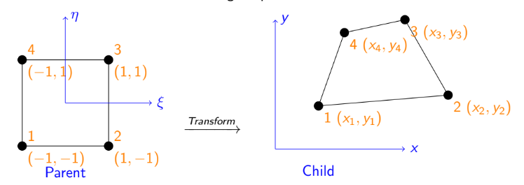

# Natural Coordinates  
*Created on:* 2024-12-03  
*Tags:* #naturalCoordinates
*Course:* [[FEM]]

---
## Definition
*Alternate method to find the shape functions of an element.*

- Parent rectangular element in natural coordinates $(\xi,\eta)$ transformed to the child element in the real $(x,y)$ coordinates.
- Natural coordinates vary from -1 to 1.
- Size of the parent element is $2\times2$ irrespective of the actual element size in real Cartesian coordinates.

*Coordinate Transformation*
Interpolation of coordinates of a point within the element from nodal points. Shape function denoted as $N_{c}$.

*Variable Interpolation*
Interpolation of the unknown field variable. Shape function denoted as $N_{v}$

Based on the these two interpolations, elements are classified as 
- Isoparametric elements: $N_{c} = N_{v}$
- Sub-parametric elements: $N_{c} < N_{v}$
- Super-parametric elements: $N_{c} > N_{v}$

*Transformation from natural to real coordinates*

$$
x(\xi, \eta) = \sum N_{i}\,x_{i}
$$
$$
y(\xi,\eta) = \sum N_{i}\,y_{i}
$$
