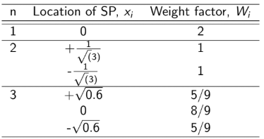

# Numerical Integration 
*Created on:* 2024-12-03
*Tags:* #numericalIntegration #trapezoidalRule #simpsonsRule #NetwonCoteRule #GaussQuadrature
*Course:* [[FEM]]

---
## Definition
*Methods to perform integration numerically specifically in computer program.*

### Trapezoidal Rule
- Uniformly spaced discrete points and corresponding function values.
- Linear approximation within each segment

$$
\int f(x)\,dx \approx \left( \frac{d}{2} \right)f_{0} + df_{1} + df_{2}+ \dots + df_{n-1} + \left( \frac{d}{2} \right)f_{n} 
$$
### Simpson's Rule
- Quadratic approximation within each segment

$$
\int f(x)\,dx \approx \frac{d}{3}\,\left(f_{0} + f_{n} + 4\sum_{i=1,3,5,\dots}^{n-1} f_{i} + 2\sum_{i=2,4,6,\dots}^{n-2} f_{i} \right) 
$$
### Newton-Cotes Formula
- Value of $f(x)$ known at $n$ arbitrary points $x_{i}$. 
- Approximate $f(x)$ using a $(n-1)^{th}$ order polynomial $g(x)$
$$
f(x) \approx g(x) = c_{0} + c_{1}x + c_{2}x^2 +\dots+c_{n-1}x^{n-1}
$$
- Solve the n equations in n unknowns and solve for $c_{0}, c_{1}, c_{2},\dots,c_{n-1}$.
- Once coefficients are determined, the integral is
$$
\int_{-1}^1 f(x)\,dx \approx \int_{-1}^1 g(x)\,dx
$$

$$
\int_{-1}^1 g(x)\,dx = 2c_{0}\, +\, 0\, +\, \frac{2}{3}c_{2}\, +\,0\, +\, \frac{2}{5}c_{4}\, +\,\dots  
$$
### Gauss Quadrature
- Attempts to find the location of sampling points $x_{i}$ and the weight factors $W_{i}$ to reduce computational effort and improve the accuracy.
- The function is approximated by a polynomial of degree p.
$$
f(x) \approx g(x) = c_{0} + c_{1}x + c_{2}x^2 +\dots+c_{p}x^{p}
$$
$$
\int_{-1}^1 g(x)\,dx = 2c_{0}\, +\, 0\, +\, \frac{2}{3}c_{2}\, +\,0\, +\, \frac{2}{5}c_{4}\, +\,\dots\, + \frac{c_{p}}{p+1}[1-(-1)^{p+1}]  
$$

- The general formula to express the integral is
$$
I \approx W_{1}f_{1} + W_{2}f_{2} + W_{3}f_{3} + \dots + W_{n}f_{n}
$$
- Putting the approximation of $f(x)$ in the above equation and comparing coefficients $c_{0}, c_{1}, c_{2},\dots,c_{p}$, we get p+1 equations for 2n unknowns.

- Solving the above p+1 equations, we get the unknown locations as well as the weights.
- For a given number of points, Gauss quadrature can integrate a much higher order polynomial $p = 2n-1$.
- For n=1, p = 1 (Linear polynomial).
- For n=2, p = 3 (Cubic polynomial).

