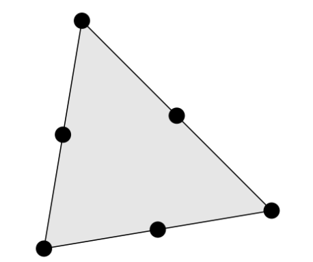
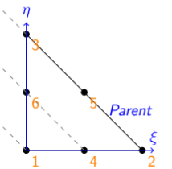
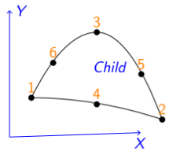

# Six-noded triangle  
*Created on:* 2024-12-03  
*Tags:* #tri6 #quadraticTri
*Course:* [[FEM]]

---
## Definition
*The corners nodes of a triangle are supplemented by nodes at the center of each edge.*

$$
T(x,y) = c_{0} + c_{1}x + c_{2}y + c_{3}x^2 + c_{4}xy + c_{5}y^2
$$

Higher-order polynomial with six nodes.

## Shape Functions

 

Using [[Natural Coordinates]],
-  $N_{1}$ = $SF\,\,\times$ (Eqn of line through 2,3,5) x (Eqn of line through 4,6)
-  $N_{2}$ = $SF\,\,\times$ (Eqn of line through 1,3,6) x (Eqn of line through 4,5)
-  $N_{3}$ = $SF\,\,\times$ (Eqn of line through 1,2,4) x (Eqn of line through 5,6)
-  $N_{4}$ = $SF\,\,\times$ (Eqn of line through 1,3,6) x (Eqn of line through 2,3,5)
-  $N_{5}$ = $SF\,\,\times$ (Eqn of line through 1,4,2) x (Eqn of line through 1,6,3)
-  $N_{6}$ = $SF\,\,\times$ (Eqn of line through 1,4,2) x (Eqn of line through 2,5,3)

Thus,
- $N_{1} = (\eta + \zeta - 1)(2\eta + 2\zeta - 1)$
- $N_{2} = \zeta\,(2\zeta-1)$
- $N_{3} = \eta\,(2\eta-1)$
- $N_{4} = 4\zeta\,(\eta+\zeta)$
- $N_{5} = 4\,\eta\,\zeta$
- $N_{6} = 4\eta\,(\eta+\zeta)$

$$
T(x,y) = N_{1}T_{1} + N_{2}T_{2} + N_{3}T_{3} + N_{4}T_{4} + N_{5}T_{5} + N_{6}T_{6}
$$

