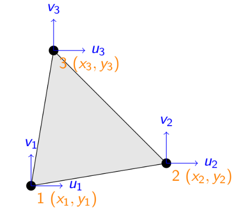

# Three-noded Triangle (CST)  
*Created on:* 2024-12-03  
*Tags:* #CST #ThreeNodedTriangle #Tri3
*Course:* [[FEM]]

---
## Definition

$$
T(x,y) = c_{1}x + c_{2}y + c_{0}
$$

$$
T(x,y) = N_{1}T_{1} + N_{2}T_{2} + N_{3}T_{3}
$$
Where,
$$
N_{1} = \frac{\alpha_{1} + \beta_{1}x + \gamma_{1}y}{2\Delta}
$$
$$
N_{2} = \frac{\alpha_{2} + \beta_{2}x + \gamma_{2}y}{2\Delta}
$$
$$
N_{3} = \frac{\alpha_{3} + \beta_{3}x + \gamma_{3}y}{2\Delta}
$$
$$
\begin{gathered}
\alpha_{1} = x_{2}y_{3} - x_{3}y_{2}\\
\beta_{1} = y_{2} - y_{3}\\
\gamma_{1} = x_{3} - x_{2}
\end{gathered}
$$

And $\alpha_{2}$, $\beta_{2}$, $\gamma_{2}$ are calculated cyclically.

$$
[K]^e = [B]^T\,[D]\,[B]\,t\,A
$$

Constant strain triangle (CST) has a constant strain/flux due to linear variation of the variables.

