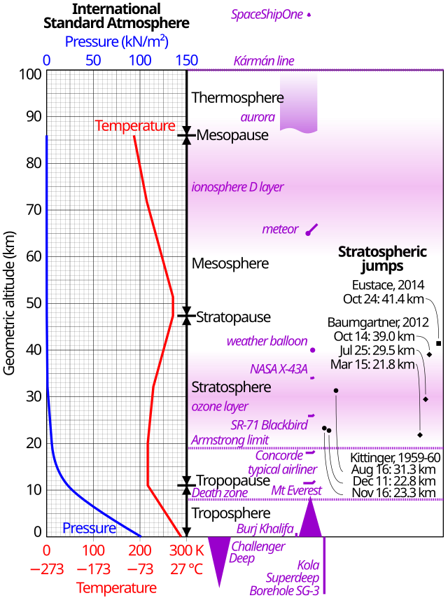

# Atmosphere
*Created on:* 2025-01-20  
*Tags:* #StandardAtmosphere #Classification #PressureAltitude #Airspeeds
*Course:* [[Flight Mechanics]]

---
## Altitude

1. Geometric Altitude ($h_{g}$): Geometric height above sea level.
2. Absolute Altitude ($h_{a}$): Height from the center of the earth i.e. $h_{a}=h_{g}+r$.
3. Geopotential Altitude ($h$): Fictitious altitude that is physically compatible with the assumption of $g=\text{const}=g_{0}$.
$$
h = \frac{r}{r+h_{g}}h_{g}
$$
4. Pressure Altitude ($h_{p}$): The standard altitude which corresponds to the free-stream pressure according to the standard atmosphere.
5. Temperature Altitude ($h_{T}$): The standard altitude which corresponds to the free-stream temperature according to the standard atmosphere.
6. Density Altitude ($h_{\rho}$): The standard altitude which corresponds to the free-stream density according to the standard atmosphere.
## Standard Atmosphere.

- Earth's atmosphere is a dynamically changing system.
- The pressure and temperature of the atmosphere depend on the altitude, location on the globe, time of day, season, and even weather.
- To account these variations for design of aircrafts/spacecrafts is impractical.
- A standard atmosphere is defined in order to relate flight tests, wind tunnel results, and general airplane design and performance to a common reference.
- It gives the value of pressure, temperature, density, and other properties as a function of altitude.
- These were obtained from experimental balloon and sounding rocket measurements.
- Based on the defined variation of $T$ with altitude.
- It has series of straight lines which are vertical as well as inclined.

- The value of temperature gradient in the troposphere is $-6.5K/Km$.
- The properties at sea-level are known.
