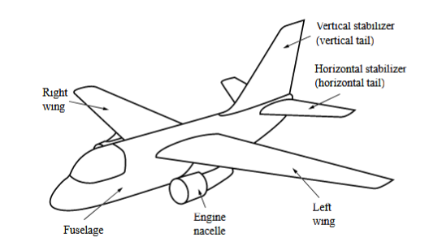

# Aircraft Configuration 
*Created on:* 2025-01-20 
*Tags:* #AircraftConfiguration
*Course:* [[Flight Mechanics]]

---
## Anatomy of Airplane

1. Fuselage: Center body where most of the usable volume of the airplane is found.
2. Wings: The main lift-producing components of the airplanes.
3. Stabilizers: The horizontal and vertical stabilizers are located and sized so as to provide necessary stability for the airplane in flight. Sometimes known as tails or fins.
4. Nacelle: Engine housing
5. Flaps and Control Surfaces

