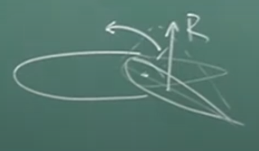

# Static Stability 
*Created on:* 2025-01-29  
*Tags:* #Static #Stability
*Course:* [[Flight Mechanics]]

---
## Longitudinal Static Stability

- The value of $\frac{\partial C_{m,cg}}{\partial \alpha}$ is negative. Allows recovery from disturbances.
- The value of $C_{m_{0}}$ is positive.
- The trim angle $\alpha_{e}$ should fall within the flight range of angle of attack for the aircraft to be trimmed for steady flight. Since, the elevator position is fixed.

For positively cambered airfoil, the value of $C_{m_{0}}$ is negative. Thus, for the wing alone configuration is unstable. Hence, the requirement of a tail.

The moment of the airplane $M_{cg,w}$ about the center of gravity due to the wing is found as
$$
C_{M,cg_{w}} = C_{M,ac_{w}} + C_{L,W}(h-h_{ac_{w}})
$$
The center of gravity is $hc$ distance from the leading edge and the aerodynamic center is $h_{ac,w}c$ distance from the leading edge.

- The wing's contribution is due to two factors
	- Moment about the aerodynamic center
	- Lift acting through the moment arm

The moment can be modified to include the contributions from the body as
$$
C_{M,cg_{wb}} = C_{M,ac_{wb}} + C_{L,wb}(h-h_{ac_{wb}})
$$

## Contribution of Tail to $M_{cg}$

- The tail lies in the wake of the wing.
- The airflow at the tail is deflected downward by the downwash, hence the incident wind on the tail is not the same as free-stream wind.
- The flow speed is slower than $V_{\infty}$

$$
C_{M,cg_{t}} = - a_{t}V_{H}\alpha_{wb}\left( 1-\frac{\partial\varepsilon}{\partial \alpha} \right) + a_{t}V_{H}(\varepsilon_{0}+i_{t})
$$
The total pitching moment about the center of gravity is given as
$$
C_{M,cg} = C_{M,cg_{wb}} + C_{M,cg_{t}}
$$
- $C_{M,0}$ should be positive and hence $i_{t}$ must be a positive quantity.
- $\partial C_{M,cg}/\partial \alpha$ must be a negative quantity, which is dictated by the quantity $V_{H}$ known as tail volume coefficient.

## Neutral Point

- The point where the slope of moment of coefficient is zero.
- It is analogous to aerodynamic center of wing.
- For longitudinal stability, the center of gravity should be ahead of the neutral point i.e. $h<h_{n}$.

$$
h_{n} = h_{ac_{wb}} + V_{H} \frac{a_{t}}{a}\left( 1-\frac{\partial\varepsilon}{\partial \alpha} \right)
$$

## Static Margin

The distance $h_{n} - h$ is defined as the static margin. It is direct measure of longitudinal static stability. 
- The static margin should be positive.
- The larger the static margin, the more stable the airplane.

## Stick-Fixed V/S Stick-Free 

- The stability analysis with fixed controls is known as *stick-fixed static stability*.
- In steady level flight, the control stick is left essentially free; in turn the elevator is left to float under the influence of the natural aerodynamic forces and moments at the tail.
- The stability with free controls is known as *stick-free static stability*.

## Elevator Hinge Moment

- A moment will be exerted about the hinge line, trying to rotate the elevator upward. This is known as the elevator hinge moment.
- $H_{m} = f(\alpha_{t}\,,\delta_{e})$
- The elevator hinge moment coefficient $C_{h_{e}}$
$$
C_{h_{e}} = \frac{H}{\frac{1}{2}\rho_{\infty}V_{\infty}^2S_{e}c_{e}}
$$

- For stick-free longitudinal static stability, the hinge moment is zero.