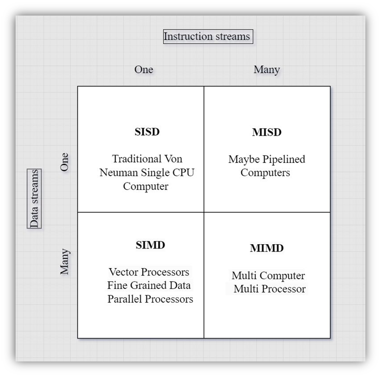

# Computing Architecture 
*Created on:* 2025-02-03  
*Tags:* #ComputingArchitecture
*Course:* [[HPC]]

---
## Basic Computing Model

- Types of Computers
	- Desktop Computer
	- Embedded Computer
	- Tablet
	- Server
	- Supercomputer

- Simplified Model of a computer
	- Hardware -> OS -> Application System -> User
- Simplified view of the hardware
	- Input Device --> Processor ---> Output Device
	- Main Memory <---> Processor
- Basic computing model
	- Programmers use High-level programming Language
	- CPU understands machine language or assembly language
	- High level language statement is converted to assembly language by system software tools.
- Heart of the processor
	- ALU- Arithmetic Logic Unit
	- Takes instructions and data --> Outputs the results.
- Instructions, data and results are stored in the Storage Device.

## Flynn's Taxonomy

- In 1966, Michael J. Flynn proposed classification of computer architectures.
- SI: Single Instruction - All processors execute same instruction.
- MI: Multiple Instruction - Different processors may be executing different instructions.
- SD: Single Data - All processors are operating on the same data
- MD: Multiple Data - Different processors operating on different data.

## Single Instruction Single Data

- A sequential computer which doesn't incorporate any parallelism.
- Standard single CPU serial computer and program
- Building block for parallel computing systems.

## Single Instruction Multiple Data

- The first use of SIMD was in vector supercomputers like Cray platforms.
- SIMD instructions are executed by ALU in modern processors.
- Useful for applications that handle streaming data for example audio and video.
- GPUs use this concept.

## Multiple Instruction Single Data

- Multiple instructions operate on a single data stream.
- Rarely implemented architecture.
- Possible uses
	- For fault tolerance
	- Multiple frequency filters
	- Cracking messages coded using cryptographic techniques.

## Multiple Instruction Multiple Data

- Most of the parallel computers are of this type.
- Two varieties of implementation
	- Shared Memory
	- Distributed Memory

## Process Basics

- Source Code is compiled to Object code.
- Object code is converted to Binary code through Linker.
- Executable file is stored on secondary storage as binary code.
- A users runs this program.
- The loader loads the program in main memory and runs it.
- When a program gets into execution, it is called a process.
- To accomplish what it wants to do, while running a process needs resources like,
	- CPU time
	- Additional memory
	- Files on hard disk
- Resources are allotted by the OS to a process either when it is created or while it is executing.

## Operating System and program

- Early computer systems allowed only one program to be executed at a time.
- When running, the process has complete control of the system and use all its resources.

## Multiprogramming for optimal CPU usage

- CPU scheduling is a fundamental characteristics of multi-programming.
- Single processor systems can run only one process at a time.
- Other processes have to wait till the CPU becomes free.
- The objective of multiprogramming is keeping the CPU busy always.
- Some processes has to be running at all the times.
- A process keeps running till it has to wait, typically for an I/O request to complete.
- The OS takes the CPU from the waiting process and gives it to another process.
- The processes are run on the CPU in time-sliced manner.
- Each processes gets a slice of time to run on CPU.
- When slice is over, the OS assigns another process to run on the CPU.
- This is known as context switching.

## Threads

- Thread is a light weight process, which is a basic unit of CPU utilization.
- The traditional process has a single thread.
- Modern process consists of multiple threads.
- The reason for having multiple threads is, the process can perform multiple tasks,
- Benefits:
	- Responsive
	- Resource Sharing
	- Economy
	- Useful for Multiprocessor Architecture.
- Scheduling Criteria
	- CPU Utilization
	- Throughput
	- Turnaround time
	- Waiting time
- Multiprocessor Scheduling
- Asymmetric Multiprocessing: The master server takes scheduling decisions.
- Symmetric Multiprocessing: Each processor does self-scheduling, picking up tasks from ready queue.