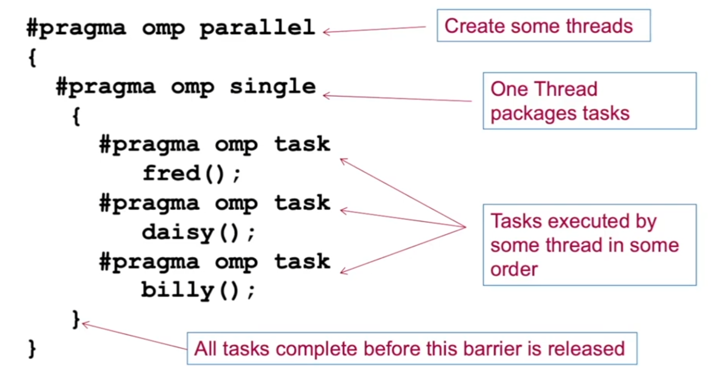

# Irregular Parallelism 
*Created on:* 2025-02-19  
*Tags:* #IrregularParallelism #OpenMP
*Course:* [[HPC]]

---
## Single Worksharing Construct

- If the code block execution time is irregular then, inside a single construct block, the part can be shared into multiple tasks on different threads.
- A single construct denotes a block of code that is executed by only one thread (not necessarily the primary* thread).
- A barrier is implied at the end of the single block which can be removed with *nowait* clause.
```C++
#pragma omp paralle
{
	do_many_things();
	#pragma omp single
	{ exchange_boundaries();}
	do_many_other_things();
}
```

- Task Directive - `#pragma omp task`


- A data race is when threads "race to update a shared variable". They produce race conditions. Programs contains data races are undefined.

> [!Example] Data Race Program
> Write a program using tasks that will randomly generate one of two strings:
> - "I think" "race" "car" "s are fun"
> - "I think" "car" "race" "s are fun"  

```C++
#include <stdio.h>
#include <omp.h>
int main(){
	printf("I think");
	#pragma omp parallel
	{
		#pragma omp single
		{
			#pragma omp task
			printf(" car");
			
			#pragma omp task
			printf(" race");
		}
	}
	print("s are fun!\n");
}
```

- The behavior wanted for tasks is usually firstprivate, because the task may not be executed until later (and variables may have gone out of scope).
	- Variables that are private when the task construct is encountered are firstprivate by default.
- Variables that are shared in all constructs starting from the innermost enclosing parallel construct are shared by default.

## Example: Fibonacci Numbers

```C++
int fib(int n){
	int x,y;
	if (n<2) return n;
	x = fib(n-1);
	y = fib(n-2);
	return (x+y);
}

int main(){
	int NW=5000;
	fib(NW);
}
```

- Very inefficient $O(2^n)$ recursive implementation.

```C++
int fib(int n){
	int x,y;
	if (n<2) return n;\
	
	#pragma omp task shared(x)
	x = fib(n-1);
	#pragma omp task shared(x)
	y = fib(n-2);
	#pragma omp taskwait
	return (x+y);
}

int main(){
	int NW=5000;
	#pragma omp parallel
	{
		#pragma omp single
		fib(NW);
	}
}
```

- A task cannot complete until all tasks below it in the tree are complete (enforced with taskwait)
- x, y are local and so by default they are private to current task.
- Must be shared on child tasks so they don't create their own firstprivate copies at this level.
