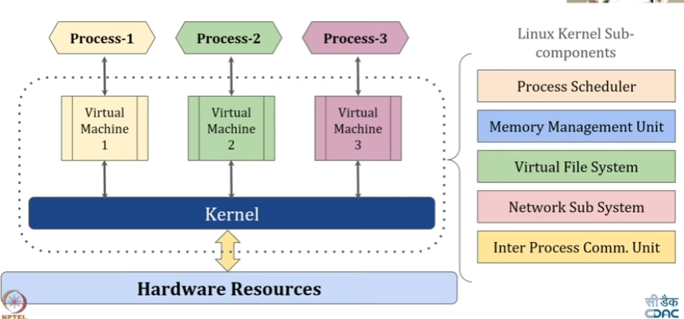

# Linux Kernel 
*Created on:* 2025-01-22  
*Tags:* #Linux #Kernel
*Course:* [[HPC]]

---
## Kernel

- The kernel provides a platform for programs and various services to run on top of it.
- It is responsible for managing system resources, handling hardware communication and ensuring smooth execution of processes.
- Linux Kernel follows a monolithic architecture i.e. it runs as a single large process in a privileged mode which the hardware sees.
- For the other applications/codes, it creates virtual machines and manages them.
- It supports Loadable Kernel Machines (LKMs), allowing dynamic addition or removal of features which allows various flavors of Linux.

> **Kernel**
> It virtualizes the computer's common hardware resources to provide each process with its own virtual resources.

## Process Scheduler

- Responsible for managing how processes are allocated to the CPU.
- Maximize CPU utilization and ensure smooth multitasking by determining which processes get CPU time and for how long.
- Scheduling Policy
- Process States
- Preemptive v/s Non-preemptive scheduling
- Context Switching
- Load Balancing

## Memory Management Unit

- It is responsible for efficiently managing both physical and virtual memory.
- Address Translation (Virtual to Physical mapping)
- Page Table: to store the mapping between virtual addresses and physical addresses.
- TLB (Translation Lookaside Buffer): a small, fast cache to store recent data
- Memory protection, Cache Control, etc.

## Virtual File System

- It is an abstraction layer that allows the Linux kernel to interface with different file systems in a uniform way.
- Superblock: Represents an entire mounted file system.
- Inode: Stores metadata about individual files or directories.
- Dentry: Represents directory entries
- Mount Points: Where file systems are mounted.
- File system operations, types.

## Network Sub-System

- It manages communication between devices over a network.
- It is responsible for processing, routing, and managing all network packets as they pass through the system.
- Socket API: Interface between user-space applications and the kernel.
- Protocol
- Network stack, network devices.
- Packet Processing.

## Inter Process Communication (IPC) Unit

- It allows processes to communicate and synchronize their actions with each other.
- This communication is essential for tasks that require collaboration between multiple processes or need shared access to system resources.
- Message Queues - allow processes to exchange messages.
- Shared memory - allows multiple processes to access the same memory region.
- Semaphores (Synchronization Primitives), Signals (Asynchronous notifications), etc.

## Linux Library Files

- In the linux mostly everything is a file.
- The abstraction simplifies interaction with various components of the system.
- System libraries are essential components that provide commonly used functions and services to program.
- System libraries are shared by multiple applications, making them highly efficient in terms of memory usage and execution speed.
- Regular files: text files, binary files, scripts.
- [Directories](Linux%20Directory.md): File that contain information about other files.
- Devices: Devices are represented as files in the /dev directory.
- Symbolic link: A file that points to another file or directory.
- Network Interfaces: Treated like files within Linux.
