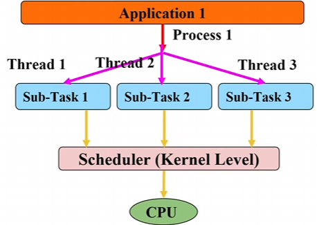

# Linux Process 
*Created on:* 2025-01-28  
*Tags:* #Linux #Process
*Course:* [[HPC]]

---
## Definition

- A process is an executing instance of a program.
- Each process in Linux has:
	- Process ID
	- Parent Process ID
	- User ID
	- State
- Linux process management involves the creation, monitoring and control of processes.
- Two types of processes:
	- Background Processes: Run in the background allowed the terminal to be used for other tasks.
		- To run a process in the background : *command &*
	- Foreground Process: Run directly from the terminal and occupy it until they finish execution.
		- Brings a background job to the foreground : *fg %1*
- Process in Linux can be in various states
	- Running (R)
	- Sleeping/Waiting (S)
	- Stopped/Finished (T)
	- Zombie (Z)

## Important Commands

1. See/Display a list of running processes - *ps*
2. List of all running process with full information without any regard to the current user - *ps -ef*
3. See/Display the real-time information about the currently running processes - *top*
4. Terminate/Kill the process - *kill PID*
	1. SIGTERM (15): Gracefully terminates a process, allowing it to clean up resources (Default).
	2. SIGTERM (9): Forces immediate termination of the process without cleanup.
	3. SIGSTOP (19): Pauses the process.
	4. SIGCONT (18): Resumes a paused process.

## Multitasking v/s Multi-Threading

- Multitasking : Execution of multiple processes (Context Switching)
- Multi-threading: Execution of multiple threads in a process (Threads Switching)

## Linux Text Processing 

- Powerful commands for text processing, allowing users to manipulate, filter, search, etc.
- Search for patterns in a file : *grep "pattern" fileName*
	- *-n*: Line number where the pattern is present.
	- *-r*: to find in number of files and directories. Replace fileName with *
- Pattern scanning and processing - *awk*
	- Printing selected columns: *awk "{print $1 $3}" file.txt*
	- Filtering rows based on condition: *awk '$3 == "M" {print $1}' file.txt*
	- Using arithmetic operations: *awk '{print $1, $2 * 2}' file.txt*
	- Pattern Matching: *awk '/John/ {print $0}' file.txt*
- Sort lines of text file - *sort*
	- Sort alphabetically - *sort*
	- Sort numerically - *sort*
	- Reverse sort - *sort -r*
	- Omit repeated lines from a sorted file - *sort fileName | uniq*
- Pipe | --> Passes the output of one command to the next command.
- Count content of a file - *wc*
	- *-l* - Lines
	- *-w* - Words
	- *-c* - Characters
- Print the first/last *n* lines - *head/tail*
- Compare files line by line - *diff file1 file2*
- Merge lines of the files - *paste file1 file2*