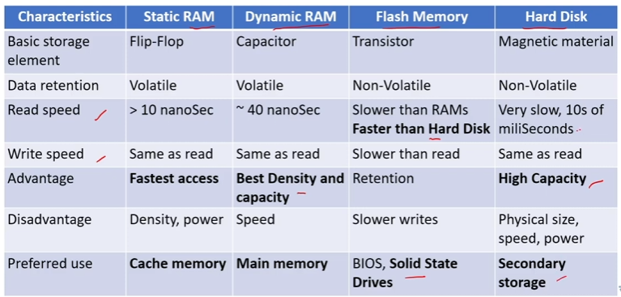
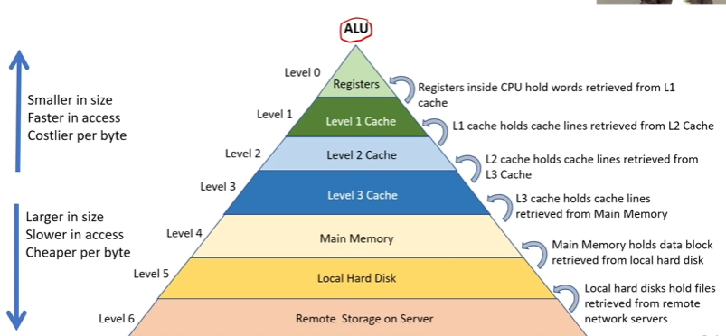
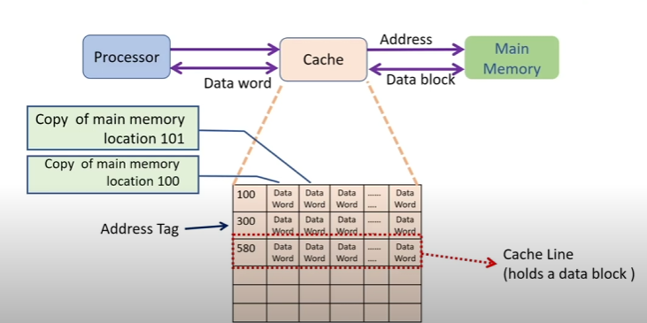

# Memory Systems 
*Created on:* 2025-02-04  
*Tags:* #MemorySystems
*Course:* [[HPC]]

---
## Definition

- Types
	- Static RAM
	- Dynamic RAM
	- Flash Memory
	- Hard Disk

## How CPU access memory ?

- Read: A load instruction is decoded. The operand is address.
- CPU puts the address on the Address Bus.
- Memory responds with data from the specified address and put on the Data Bus.
- CPU accepts the data.
- Write: Store instruction specifies address and data.
- CPU address and data on bus.
- Memory stores the data at specified address location.

## Memory Requirements

- Programmers want unlimited amount of fast memory.
- Realities
	- Fast memory is costly (SRAM).
	- Programs tend to follow principle of locality.
		- Temporal: Same location is repeatedly accessed.
		- Spatial: Close by locations are accessed soon.
- Hardware aids programmer by creating an illusion of unlimited fast memory.
- Memory are not able to keep up with the achieved by microprocessors.
- Interleaving the memory
	- Odd address in one bank and even address in another bank.
	- Results in overlapping memory delays and speedup the operations.
- Wider memory paths
	- More data is fetched per access cycle.
- Cache memory system
	- Faster memory to serve frequently used data and code.

## Memory Hierarchy

- Takes advantage of principle of locality.
- Memory subsystem consists of multiple levels with different speeds and sizes.
- Small fast memory is put close to processor and slower away.
- Maximum memory which is cheapest.
- Access at the speed offered by the fastest.
- Data is copied only between two adjacent levels.
- If data is found in level closest to CPU, it's a hit.
- Hit rate is a measure of the performance.

## Cache

- A safe place for hiding or storing things
- Contains a copy of portions of main memory
- Acts as a buffer between CPU and main memory.
- Cache memories work on the phenomenon of locality of reference.
- If a memory location is referenced by the processor, then it is very likely that the same memory location as well the nearby address blocks are to be accessed by the CPU.
- It consists of 3 main parts
	- Directory Store: Information about the origin about data.
	- Data Section
	- Status Information
- Cache controller is a hardware that copies information from main memory to cache memory automatically.
- Mapping scheme helps in replacing old data with new data.
- Cache efficiency is measured through hit rate.

## MIMD Systems

- Shared Memory
	- Symmetric Multiprocessing (SMP): All the processors share the same memory and I/O facilities including access time. 
	- Non-Uniform Memory Access: All processors have access to all parts of main memory but the access time differs.
	- There is a practical limit on the number of processors and memory which could be used in SMP.
- Distributed Memory
	- Cluster: A group of interconnected, standalone commodity computers that work together as a unified computer resource.
	- Extreme scalability.
	- Incremental scalability
	- Availability
	- Superior price/performance.
	- Dependent on Bandwidth and Latency.