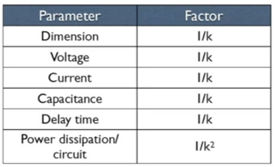
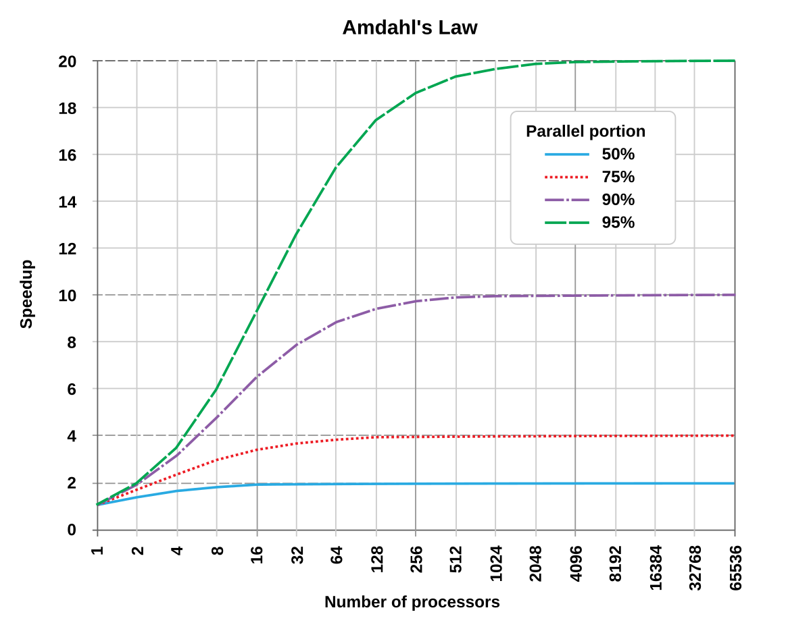

# Need for Parallel Computing 
*Created on:* 2025-02-07  
*Tags:* #NeedforParallelComputing
*Course:* [[HPC]]

---
## Moore's Law

- Number of transistors packed in a square inch area doubles every 18 months.
- Moore's law is still standing.
- MOSFET is the building block of all computers.
## Dennard Scaling of MOSFET's

- Dennard scaling is broken and the voltage limit to identify the binary states 0 and 1 have been reached.
- Frequency, typical power and single-threaded performance has become stagnant over recent few years.
- While the number of cores have increased to improve the performance.
- This is only possible option to improve performance.

## Parallel Computing

- High performance computing involves parallel programming.
- You cannot run away from parallel programming in the future.
- Problem is people don not think in parallel.
- Automatic parallelization has been a disaster so far.
- There are other limits/roadblocks to parallelism. Messages need to be communicated.
- Amdahl's Law

## Amdahl's Law

Amdahl's law states that if $P$ is the proportion of a program that can be made parallel (i.e. benefit from parallelization) and (1-P) is the proportion that cannot be parallelized (remains serial), then the maximum speedup that can be achieved by using $N$ processors is given as

$$
S(N) = \frac{1}{(1-P)+\frac{P}{N}}
$$
For $N \rightarrow 0$, $S(N) = \frac{1}{1-P}$

