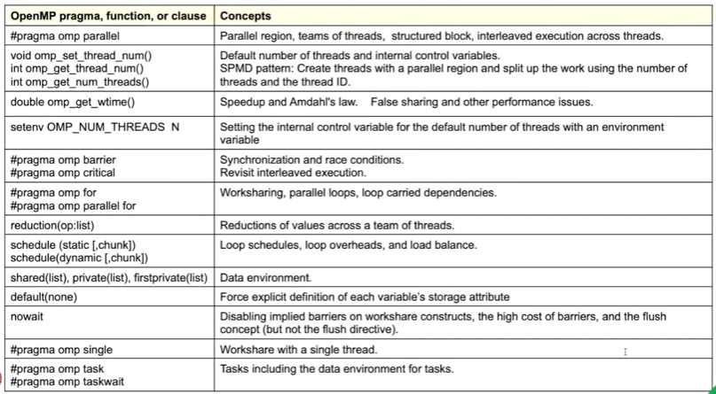
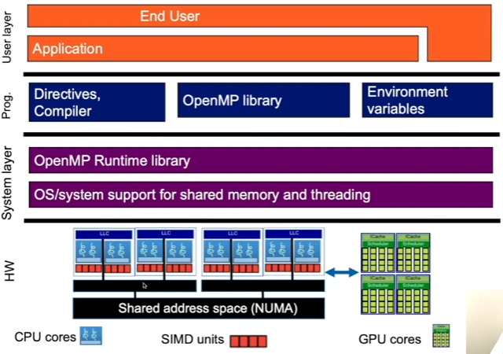
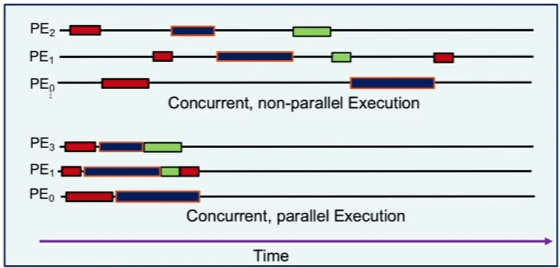
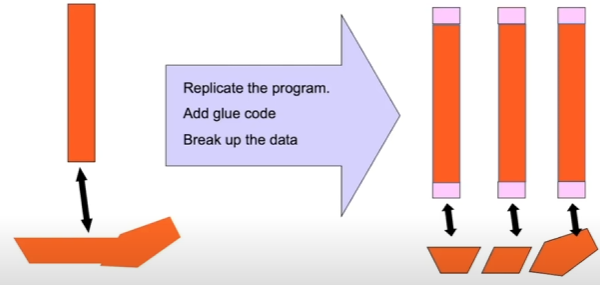

# OpenMP Programming 
*Created on:* 2025-02-16  
*Tags:* #OpenMP #Programming
*Course:* [[HPC]]

---
## Definition

- Shared Memory Programming using OpenMP
- OpenMP: An API for writing parallel applications.
- Greatly simplifies writing multithreaded programs in Fortran, C, and C++.

## OpenMP Common Cores

Most OpenMP programs only use these 21 items


## OpenMP Basic Definitions

- We focus on Symmetric Multiprocessor Case i.e. lots of threads with "equal cost access" to memory.



## OpenMP Basic Syntax

- Most of OpenMP happens through compiler directives.
- Compiler Directives:
	- C and C++: `#pragma omp construct [clause [clause]]`
	- Fortran: `!$OMP construct [clause [clause]]`
- Example
```C
#pragma omp parallel private(x)
{

}
``` 

```Fortran
!$OMP PARALLEL PRIVATE(X)

!$OMP END PARALLEL
```

- Function Prototypes and types:
	- `#include <omp.h>` or `use OMP_LIB`
- Most OpenMP constructs apply to a "structured block".

## Exercise, Part A: Hello World

- Serial Version
```C++
#include <stdio.h>

int main()
{
printf("Hello");
printf("world\n");
}
```
- Parallel Version
```C++
#include <omp.h>
#include <stdio.h>

int main()
{
 #pragma omp parallel
 {
 printf("hello");
 printf("world\n");
 }
}
```

- The statements are interleaved based on how the operating schedules the threads.
- The misprint in the output is due to lack of synchronization.

## Terminology in Parallel Computation

- *Task*: A sequence of instructions plus a data environment. A program is composed of one or more tasks.
- *Active Task*: A task that is available to be scheduled for execution. When the task is moving through its sequence of instructions. 
- *Fair Scheduling:* When a scheduler gives each active task an equal opportunity for execution.
- *Concurrency*: A condition of a system in which multiple tasks are active and unordered.
	- If scheduled fairly, they can be described as logically making forward progress at the same time.
- *Parallelism:* A condition of a system in which multiple tasks are actually making forward progress at the same time.



## Execution Model

- Fork-Join Parallelism
	- Initial thread spawns a team of threads as needed.
	- Parallelism added incrementally until performance goals are met i.e. the sequential program evolves into a parallel program.
- The compiler directive forks and creates multiple threads.
- Number of threads handled through the environment variable `OMP_NUM_THREADS`. It can be less than or more than number of processors.
- The number of threads can be set inside the code using `omp_set_num_threads(n)`. The thread id is returned by `omp_get_thread_num()` function.

```C++
#include <omp.h>
#include <stdio.h>

int main()
{
 omp_set_num_threads(4)
 #pragma omp parallel
 {
 int ID = omp_get_thread_num()
 printf("hello world %d \n", ID);
 }
}
```

- The above program outputs using one thread at a time but the order of execution of thread is not same always.
- Each thread executes the same code redundantly.
- Once a team of threads has launched, it will not be reduced.
- `omp_get_num_threads` will return the actual number of threads in the team.

## Approximation of Pi

- Mathematically, we know
$$
\int_{0}^1 \frac{4}{1+x^2}dx = \pi
$$
- Approximation using numerical integration
$$
\Delta x \sum_{i=0}^N f(x_{i}) \approx \pi
$$

- Serial program in C++
```C++
#include <omp.h>
static long num_step = 1E5;
double step;
int main()
{
 double x, pi, sum=0.0;
 step = 1.0/(double) num_steps;
 double tdata = omp_get_wtime();
 for (int i=0;i<num_steps;i++){
 	x = (i+0.5)*step;
 	sum = sum + 4.0/(1.0+x*x);
 }
 pi = step * sum;
 tdata = omp_get_wtime()-tdata;
 prinf("pi = %f in %f secs\n",pi,tdata);
}
```

- A simple SingleProgramMultipleData in C++
```C++
#include <omp.h>
static long num_step = 1E5;
double step;
#define NUM_THREADS 2
void main()
{
 int i, nthreads;
 double pi, sum[NUM_THREADS];
 step = 1.0/(double) num_steps;
 omp_set_num_threads(NUM_THREADS);
 tdata = omp_get_wtime()
 #pragma omp parallel
 {
 	int i, id, numthrds;
 	double x;
 	id = omp_get_thread_num();
 	numthrds = omp_get_num_threads();
 	if(id==0) nthreads = numthrds;
 	for (i=id,sum[id]=0.0;i<num_steps;i+numthrds){
	 	x = (i+0.5)*step;
	 	sum = sum + 4.0/(1.0+x*x);
 	}
 }
 for(i=0, pi=0.0;i<nthreads;i++){
 	pi += step * sum[i];
 } 
 tdata = omp_get_wtime()-tdata;
 prinf("pi = %f in %f secs\n",pi,tdata);
}
```

- Promote scalar to an array dimensioned by number of threads to avoid race condition.
- A block distribution can be used i.e. divide the domain into blocks and each block is computed by each thread.
- It is advised to run a program about 5 times and take the average computation time.



- MPI programs almost always use this pattern. It is probably the most commonly used pattern in the history of parallel programming.

## Performance issues related to parallel programs.

- Ideally runtime is cut by ~1/P by parallel programs.
- Speedup: the increased performance from running on P processors.
$$
S(P) = \frac{Time_{seq}(1)}{Time_{par}(P)}
$$
- Perfect Linear Speedup: Happens when no parallel overhead and algorithm is 100% parallel.
$$
S(P) = P
$$
- Super-linear Speedup: Typically due to cache effects i.e. as P grows, aggregate cache size grows so more of the problem fits in cache.
$$
S(P)>P
$$
- The maximum possible speedup is:
$$
S = \frac{1}{\alpha}
$$
- Where $\alpha$ is the fraction of code which is serial.
- With increase in processors, the number of serial management of the threads.
- We should always pick the optimum number of threads required for the problem.

- The poor scaling of SIMD code is due to False Sharing due to `sum[i]`. The variable is sloshed back and forth between threads.
- Eliminate false sharing by padding the sum array.
```
#define PAD 8 // assume 64 byte L1 cache line size.
sum[NUM_THREADS][PAD];
```

- It is utilizing higher memory which is a disadvantage.
- The sum of each thread is stored in a different cache line.

## Synchronization

- High level synchronization included in the common core:
	- CRITICAL
	- BARRIER

### Critical Region

- Mutual Exclusion: Only one thread at a time can enter a critical region
- Threads wait their turn.
```
#pragama omp critical
```

### Barrier Region

- A point in a program all threads must reach before any threads are allowed to proceed.
- Threads wait until all threads hit the barrier. Then they can go on.
```
#pragma omp barrier
```


### Modified Pi Computation code

```C++
#include <omp.h>
static long num_step = 1E5;
double step;
#define NUM_THREADS 2
void main()
{
 int i, nthreads;
 double pi=0.0;
 step = 1.0/(double) num_steps;
 omp_set_num_threads(NUM_THREADS);
 tdata = omp_get_wtime()
 #pragma omp parallel
 {
 	int i, id, numthrds;
 	double x, sum;
 	id = omp_get_thread_num();
 	numthrds = omp_get_num_threads();
 	if(id==0) nthreads = numthrds;
 	for (i=id,sum=0.0;i<num_steps;i+numthrds){
	 	x = (i+0.5)*step;
	 	sum += + 4.0/(1.0+x*x);
 	}
 	#pragma omp critical
 	pi += step * sum;
 }
 tdata = omp_get_wtime()-tdata;
 prinf("pi = %f in %f secs\n",pi,tdata);
}

```

- It has a scalar local variable sum for each thread to accumulate the partial sums.
- No array, so no false sharing.
- The sum variable goes 'out of scope' beyond the parallel region so we must sum it inside the parallel program using critical synchronization.

## Parallel Loops

### Loop Worksharing Construct

- The loop worksharing construct splits up loop iterations among the threads in a team.
```
#pragma omp parallel
{
#pragma omp for
	for (I=0;I<N;I++){
		NEAT_STUFF(I);
	}
}
```

- The loop control index I is made "private" to each thread by default.
- It will select the number of threads and divide the loop equally over the threads automatically.
- The workload may not be equal in each case. In that case Dynamic Scheduling can be used but it is high unpredictable and non-uniform.
- Static scheduling is pre-determined and predictable by the programmer.

## Reduction

- Combination of values into a single accumulation variable. 
- There is a true dependence between loop iterations that can't be trivially removed.
- This is a very common situation called "Reduction".
- Support for reduction operations is included in most parallel programming environments.

```C++
double ave=0.0, A[MAX];
int i;
for (i=0;i<MAX;i++){
	ave+= A[i];
}
ave = ave/MAX
```

- OpenMP reduction clause: `reduction (op:list)`
- The variables in list must be shared in the enclosing parallel region.
```C++
double ave=0.0, A[MAX];
int i;
#pragma omp parallel for reduction (+:ave)
for (i=0;i<MAX;i++){
	ave+= A[i];
}
ave = ave/MAX
```

- Inside a parallel or a work-sharing construct:
	- A local copy of each list variable is made and initialized depending on the operation.
	- Updates occur on the local copy.
	- Local copies are reduced into a single value and combined with the original global value.

```C++
// PI with a loop and a reduction
#include <omp.h>
static long num_steps = 100000;
double step;
void main()
{
	double pi,sum=0.0;
	step = 1.0/(double) num_steps;
	#pragma omp parallel for reduction(+:sum)
	for (int i=0;i<num_steps;i++){
		x = (i+0.5)*step;
		sum = sum + 4.0/(1.0+x*x);
	}
	pi = step*sum;
}
```


## The nowait clause

- Critical and Barriers are really expensive. You need to understand when they are implied and how to skip them when it's safe to do so.
- There is an implicit barrier at the end of a for worksharing construct. This can be removed/prevented by using `#pragma omp for nowait`.