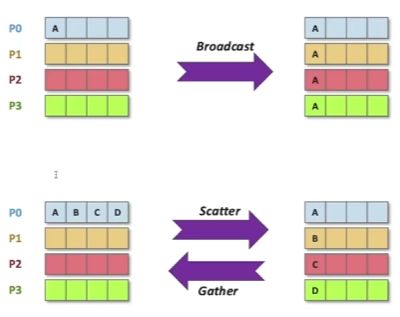
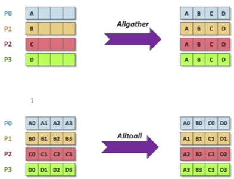
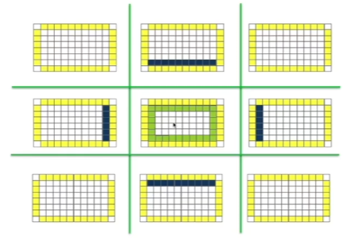
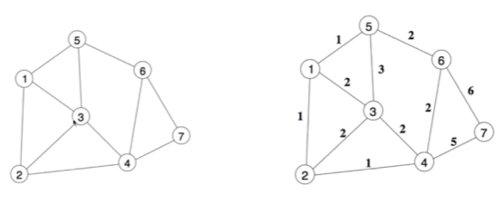

# OpenMPI 
*Created on:* 2025-02-24  
*Tags:* #OpenMPI
*Course:* [[HPC]]

---
## Definition

The Message Passing Interface Standard (MPI) is a library that allows you to do problems in parallel using message passing to communicate between processes.

- It is not a language or even an extension to a language. Instead, it is a library that your native, standard serial compiler uses.
- It is flexible enough to implement most paradigms (Data Parallel, Work Sharing, etc).
- It can be extended to multiple processors.

## Basic MPI

- The basic functionality required are the ability to:
	- Start Processes
	- Send Messages
	- Receive Messages
	- Synchronize
- With these four capabilities, you can construct any program.

## Hello World (Starting Processes)

```C
#include <stdio.h>
#include "mpi.h"

main(int argc, char** argv){

	int my_PE_num;
	MPI_Init(&argc, &argv);
	MPI_Comm_rank(MPI_COMM_WORLD, &my_PE_num);
	prinf("Hello from %d.\n", my_PE_num);
	MPI_Finalize();
}
```

- `MPI_INIT` takes two arguments from the command line which tells how many and where the process have to be run. It initializes the MPI environment.
- `MPI_Comm_rank` returns the assigned ID of the process.
- `MPI_FINALIZE`: Last MPI call. It may do a lot of housekeeping or it may not. It terminates all the processes at the end.
- By default, all variables are private to each process.

```Fortran
program shifter
include 'mpif.h'

integer my_pe_num, errcode
call MPI_INIT(errcode)
call MPI_COMM_RANK(MPI_COMM_WORLD, my_pe_num, errcode)
print *, "Hello from ", my_pe_num, '.'
call MPI_FINALIZE(errcode)
end
```

- The order of the result here is also random. All processes are treated equally, thus it requires synchronization.

## Do all nodes really run the same code ?

- All nodes run the same code independently.
- Each PE can be made to done different unique codes by control through process IDs.
- Ideally, we want a same code working on different data.

## Master and Slaves PEs

- One single PE is used for some sort of coordination purpose and the other PEs run code that is the same, although the data will be different. This is how one would implement a master/slave or host/node paradigm.
- Usually the process 0 is used as the master PE.

## Sending and Receiving Messages

Write a program which will run on 2 PEs and will send a simple message (the number 42) from PE 1 to PE 0. PE 0 will then print this out.

- Sending a message is a simple procedure.
`MPI_Send(&numbertosend,number_of_items,DataType,DestinationProcessID,MessageTag, MPI_COMM_WORLD)`

- Receiving message is equally simple and very symmetric.
`MPI_Recv(&numbertoreceive,number_of_items,DataType,Source_NODE,Source_TAG, MPI_COMM_WORLD, &status)`

- `Source_NODE` can be any source and hence the default value is `MPI_ANY_SOURCE`. Similarly, for tags we have `MPI_ANY_TAG`.

```C
#include <stdio.h>
#include "mpi.h"

main(int argc, char** argv){

	int my_PE_num, numbertoreceive, numbertosend=42;
	MPI_Status status;
	
	MPI_Init(&argc, &argv);
	MPI_Comm_rank(MPI_COMM_WORLD, &my_PE_num);
	if (my_PE_num==0){
		MPI_Recv(&numbertoreceive, 1, MPI_INT, MPI_ANY_SOURCE, MPI_ANY_TAG, MPI_COMM_WORLD, &status);
		prinf("Number received is: %d.\n", numbertoreceive);
	}
	else MPI_Send(&numbertosend,1,MPI_INT,0,10,MPI_COMM_WORLD)
	
	MPI_Finalize();
}
```


## Collective Communication

- Collective operations are called by all processes in a communicator.
- `MPI_BCAST` distributes data from one process (the root) to all the others in a communicator.
- `MPI_REDUCE` combines data from all processes in the communicator and returns it to one process.
- In many numerical algorithms, SEND/RECV can be replaced by BCAST/REDUCE, improving both simplicity and efficiency.
-  It improves the computational efficiency.
- `MPI_SCATTER`, `MPI_GATHER`, `MPI_ALLGATHER` and `MPI_ALLTOALL` operations exist similar to ` MPI_BCAST`.
- `MPISCAN` is similar to `MPI_REDUCE`.





## Synchronization

- `MPI_BARRIER(comm)`
	- Blocks until all processes in the group of the communicator `comm` call it.
	- A process cannot get out of the barrier until all other processes have reached barrier.

## Nonblocking Collective Communication

- Nonblocking (send/recv) communication
	- Deadlock avoidance
	- Overlapping communication/computation
- Collective Communication
	- Collection of pre-defined optimized patterns
- Nonblocking collective communication
	- Combines both techniques
	- System noise/imbalance resiliency
	- Semantic advantages

## Regular Mesh Algorithms

- Many scientific applications involve the solution of PDE.
- Many algorithms for approximating the solution of PDEs rely on forming a set of difference equations
	- Finite Difference, Finite Elements, Finite Volume
- The exact form of the differential equations depends on the particular method but the point of view of parallel programming, the operations are the same.
- Five point stencil is a popular approximation solution.
- Good numerical algorithms form a matrix equation $Au=f$; Solving this requires computing $Bv$, where $B$ is a matrix derived from $A$. These evaluations involve computations with the neighbors on the mesh.
- For parallel processing: Decompose the mesh into equal sized (work) pieces.

## Domain Decomposition

- Parameters for domain decomposition:
	- N = Size of the edge of the global problem domain (assuming square).
	- PX, PY = Number of processes in X and Y dimension.
	- N % PX == 0, N % PY == 0. 
- To determine:
	- What is the position for each process in the global domain ?
	- Who are my neighbors ?
	- What are the internal and global boundaries ?
- Local Data Structures
	- Each process has its local path of the global array
	- $bx$ and $by$ are the sizes of the local array.
	- Always allocate a halo around the patch.
	- Array allocated of size $(bx+2) \times (by+2)$.
- Necessary Data Transfers	
	- Provide access to remote data through a halo exchange (5 Point Stencil).
- Simple/Predefined Datatypes
	- MPI_INT, MPI_FLOAT, MPI_DOUBLE, MPI_INTEGER
	- For more complex or user-created datatypes, MPI provides routines to represent them as well
	- Contiguous
	- Vector/Hvector
	- Indexed
	- Struct
	


## Irregular Domain Decomposition

- Metis is a library for partitioning unstructured graphs/meshes.
- The aim should be to distribute equal number of elements in each process.
- We represent the mesh as a connected graph.
- We try to distribute the vertices in the graph into subgraphs such that the number of points in each sub graph is approximately equal.
- We distribute it in such a way that the minimum number of edges are cut i.e. minimum number of communication channels are cut.
- We minimize the weights on the cut graph.
- We store these graphs as compressed storage format (CSR).
- In this format the adjacency structure of a graph with **n** vertices and **m** edges is represented using two arrays `xadj` and `adjncy`. The `xadj` array is of size `n+1` whereas the `adjncy` array is of size `2m` because we store both the edges between any two given points. 




## Example Code

- Steady State Heat Conduction
- Discretized on a square grid.
- Solves the Laplace Equation $\nabla^2 T = 0$ 

